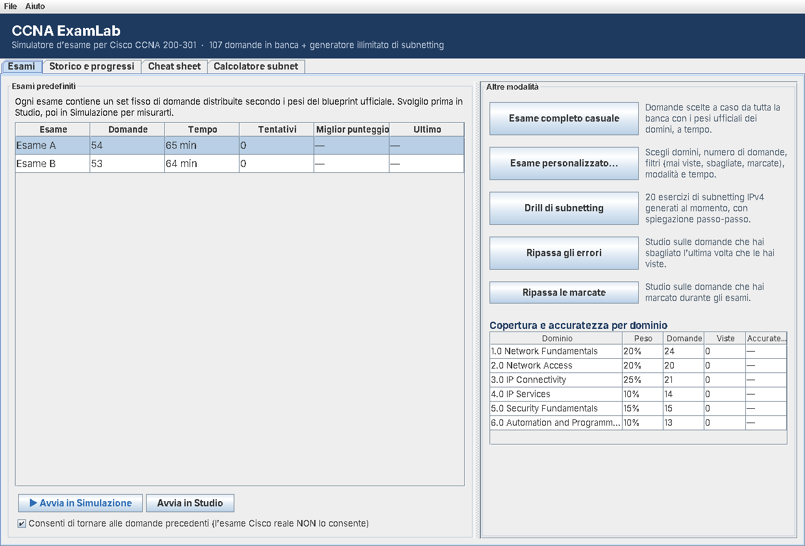
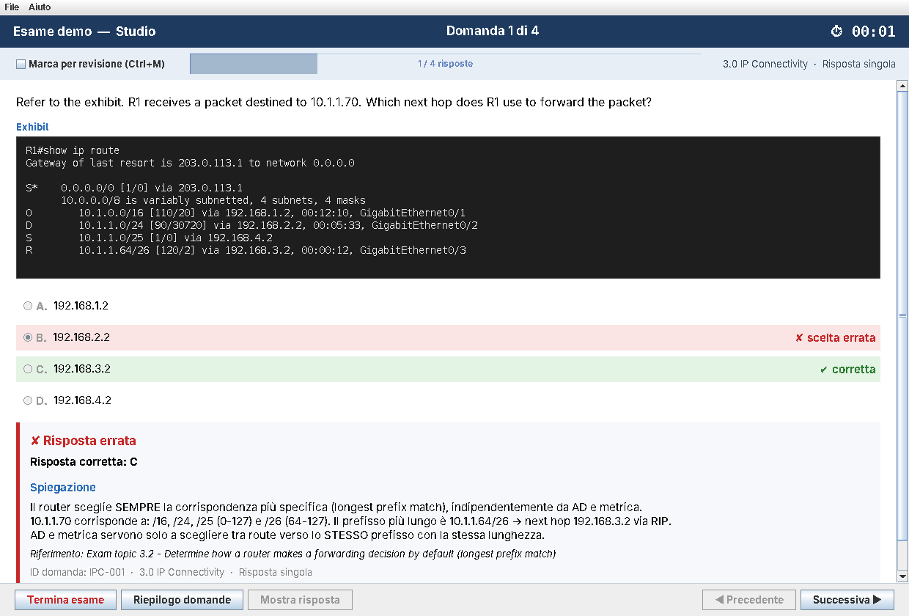
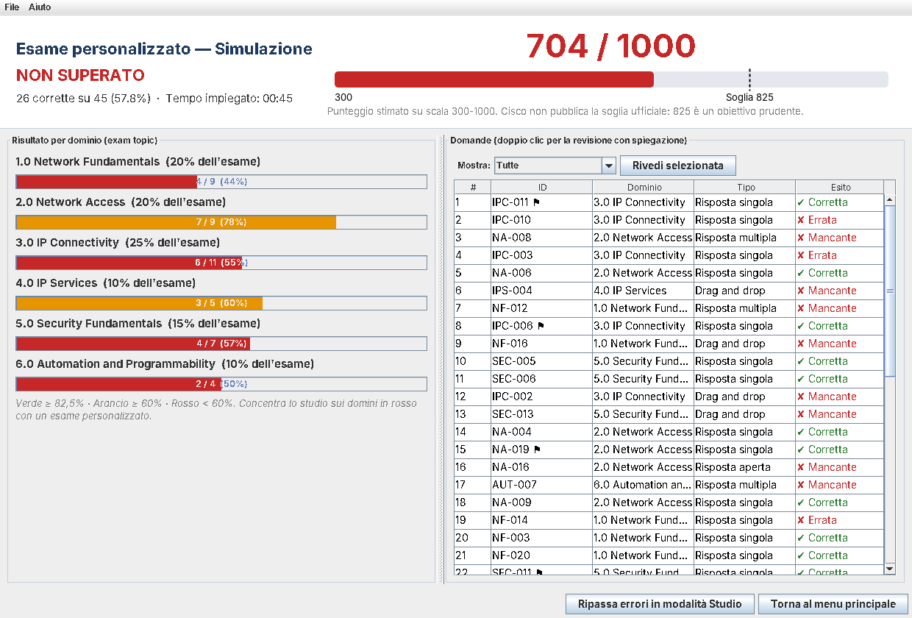

# CCNA ExamLab

Simulatore d'esame **desktop** per la preparazione alla certificazione **Cisco CCNA 200-301**, scritto in
**Java + Swing**. Usa solo la libreria standard del JDK, senza dipendenze esterne.

Segue lo stesso metodo dei migliori simulatori commerciali di practice exam: esami realistici a tempo,
modalità studio con spiegazioni dettagliate, esami personalizzati sui punti deboli e report con il
punteggio per dominio.



## Funzionalità

| Funzione | Descrizione |
|---|---|
| **Modalità Simulazione** | Tempo limite (~1,2 min/domanda, come all'esame reale). Risposte e spiegazioni visibili solo alla consegna. Puoi disattivare il ritorno alle domande precedenti, come all'esame Cisco. |
| **Modalità Studio** | Senza limite di tempo. Con "Mostra risposta" (Ctrl+R) vedi correzione, spiegazione in italiano e riferimento all'exam topic. |
| **Esami predefiniti** | Set fissi di domande (Esame A, B, …) distribuite secondo i pesi ufficiali dei domini. |
| **Esame personalizzato** | Scegli domini, numero di domande, filtro (tutte / mai viste / sbagliate / marcate), tempo e modalità. |
| **Generatore di subnetting** | Esercizi IPv4 sempre nuovi (rete, broadcast, host, maschera, host valido) con soluzione passo-passo col metodo del *magic number*. |
| **Tipi di domanda** | Scelta singola, scelta multipla ("Choose two"), drag and drop (abbinamento), risposta aperta. Exhibit con output CLI, JSON e così via. |
| **Marca e riepilogo** | Marca le domande (Ctrl+M) e apri il riepilogo con le domande incomplete o marcate. |
| **Report finale** | Punteggio su scala 300-1000 con soglia 825, esito per dominio, revisione di ogni domanda e ripasso immediato degli errori. |
| **Storico e progressi** | Storico degli esami, grafico dei punteggi e accuratezza per dominio, salvati su disco. |
| **Cheat sheet** | Schede di ripasso: subnetting, IPv6, AD, OSPF, STP, wireless, NAT/DHCP/QoS, porte, sicurezza, automazione, comandi IOS, consigli d'esame. |
| **Calcolatore subnet** | Rete, broadcast, range host, wildcard, magic number e rappresentazione binaria. |

<p>


</p>

## Contenuti

Le domande seguono il blueprint **CCNA 200-301 v1.1**. Testo e opzioni sono in inglese, come all'esame
reale; le spiegazioni sono in italiano.

| Dominio | Peso | Domande |
|---|---|---|
| 1.0 Network Fundamentals | 20% | 24 |
| 2.0 Network Access | 20% | 20 |
| 3.0 IP Connectivity | 25% | 21 |
| 4.0 IP Services | 10% | 14 |
| 5.0 Security Fundamentals | 15% | 15 |
| 6.0 Automation and Programmability | 10% | 13 |

A queste si aggiungono le domande di subnetting generate senza limiti.

> Cisco ha annunciato il blueprint **v2.0**, in vigore da febbraio 2027. I domini sono definiti in
> `Domain.java` e si possono aggiornare facilmente.

## Requisiti

- **JDK 17** o superiore (solo per compilare; per eseguire basta il JRE 17+)

## Compilazione ed esecuzione

**Senza Maven** (solo JDK):

```bash
./build.sh            # Linux / macOS  → dist/ccna-examlab.jar
build.bat             # Windows
java -jar dist/ccna-examlab.jar
```

Oppure `./run.sh` / `run.bat`, che compila se serve e poi avvia.

**Con Maven:**

```bash
mvn package
java -jar target/ccna-examlab.jar
```

**Validare i file delle domande** (utile prima di un commit):

```bash
java -jar dist/ccna-examlab.jar --validate
```

Opzioni JVM facoltative:

- `-Dccna.laf=Nimbus` per forzare un look and feel (default: quello del sistema)
- `-Dccna.examlab.home=/percorso` per cambiare la cartella dei dati utente

## Struttura del progetto

```
ccnaLearning/
├── pom.xml                      # build Maven (nessuna dipendenza)
├── build.sh / build.bat         # build con il solo JDK
├── run.sh / run.bat
├── .github/workflows/build.yml  # CI: compila e valida le domande
├── docs/screenshots/
└── src/main/
    ├── java/com/ccnaexamlab/
    │   ├── app/        Main (avvio, --validate), AppContext (servizi condivisi)
    │   ├── model/      Domain, Question, Response, ExamSession, ExamResult, ...
    │   ├── data/       QuestionParser, QuestionBank, SubnetQuestionGenerator, UserDataStore
    │   ├── engine/     ExamFactory (esami predefiniti/personalizzati), Scorer, ExamConfig
    │   ├── ui/         MainFrame, HomePanel, ExamPanel, QuestionView, ResultsPanel, ...
    │   └── util/       IpUtils (calcoli IPv4), Text
    └── resources/
        ├── questions/  banca domande in formato testo (un file per dominio + index.txt)
        └── reference/  cheat sheet in HTML (+ index.txt)
```

## Dati utente

Storico e statistiche vengono salvati in `~/.ccna-examlab/`:

- `history.tsv`: esami svolti (data, esame, modalità, punteggio, dettaglio per dominio)
- `stats.tsv`: per ogni domanda, quante volte è stata vista, risposte corrette, ultimo esito e marcatura
- `questions/`: metti qui i tuoi file `.txt` di domande; vengono caricati all'avvio

## Formato delle domande

Le domande sono semplici file di testo UTF-8. Le chiavi devono iniziare a colonna 0. Le righe che iniziano
con `#` fuori dai blocchi sono commenti.

```text
[Q]
id: NF-100                 # univoco
domain: 1                  # 1-6 oppure NETWORK_FUNDAMENTALS, ...
type: SINGLE               # SINGLE | MULTI | DRAG | FILL
text:
Testo della domanda (anche su più righe).
exhibit:
R1#show ip interface brief
Interface    IP-Address   OK? Method Status  Protocol
options:
A) Prima opzione
B) Seconda opzione
answer: B                  # MULTI: "A, C"   FILL: "risposta1 | risposta2"
explanation:
Spiegazione. `codice` e **grassetto** sono ammessi.
reference: Exam topic 1.6
[/Q]
```

Per le domande **DRAG** si usa `items:` con una coppia `elemento => categoria` per riga. Il campo
facoltativo `targets: Extra1 | Extra2` aggiunge categorie distrattrici. Per le **FILL** il confronto ignora
maiuscole e spazi superflui.

Per aggiungere un file alla banca inclusa nel programma, crealo in `src/main/resources/questions/` e
aggiungilo a `index.txt`.

## Metodo di studio consigliato

1. **Studio per argomento:** esame personalizzato su un dominio, leggendo tutte le spiegazioni.
2. **Simulazione** di un esame predefinito, senza tornare indietro.
3. **Analisi** del report per dominio e revisione degli errori.
4. **Ripasso** con "Ripassa gli errori" e "Ripassa le marcate".
5. Un **drill di subnetting** al giorno.
6. Prenota l'esame quando superi stabilmente **900** in simulazione.

## Scorciatoie da tastiera

| Tasti | Azione |
|---|---|
| Alt + → / Alt + ← | Domanda successiva / precedente |
| Ctrl + M | Marca la domanda |
| Ctrl + R | Mostra la risposta (solo modalità Studio) |

## Note legali

Progetto indipendente a scopo didattico, non affiliato né approvato da Cisco Systems, Inc.
CCNA e Cisco sono marchi registrati di Cisco Systems, Inc. Tutte le domande sono originali.
