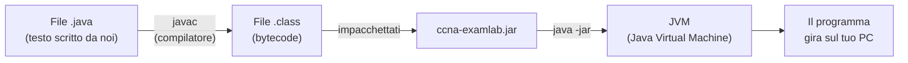
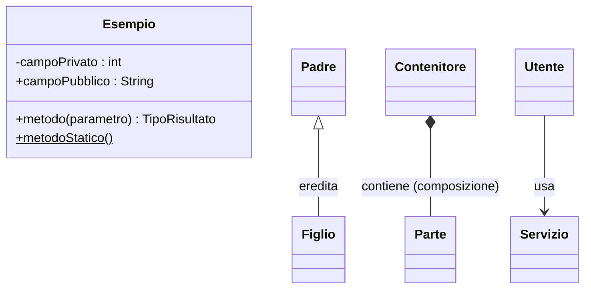

# 01 - Concetti base (per chi non ha mai programmato)

Questo capitolo spiega, partendo da zero, tutto quello che serve per leggere il resto della
documentazione. Se conosci già Java puoi saltarlo.

---

## 1. Che cos'è un programma

Un programma è una **ricetta** scritta per un computer. Come una ricetta di cucina elenca gli ingredienti e
i passi da seguire nell'ordine giusto, un programma elenca i **dati** su cui lavorare e le **istruzioni**
da eseguire.

Il computer però non capisce l'italiano: capisce solo sequenze di numeri (il *linguaggio macchina*).
Per questo le persone scrivono le ricette in un **linguaggio di programmazione** — qui **Java** — che è
un compromesso: abbastanza preciso per il computer, abbastanza leggibile per le persone.

## 2. Java, compilazione e JVM



1. Scriviamo il codice in file di testo con estensione **`.java`** (il *codice sorgente*).
2. Il **compilatore** (`javac`) li traduce in **bytecode** (file `.class`), una specie di linguaggio
   intermedio. Se c'è un errore di "grammatica" il compilatore si rifiuta e indica la riga sbagliata.
3. I file `.class` e le risorse (domande, pagine del cheat sheet) vengono impacchettati in un unico file
   **`.jar`** (è uno zip con un'etichetta che dice da dove partire).
4. La **JVM** (*Java Virtual Machine*, "macchina virtuale Java") legge il bytecode e lo esegue sul tuo
   computer. Grazie alla JVM lo stesso `.jar` funziona su Windows, macOS e Linux.

Il **JDK** (*Java Development Kit*) contiene sia il compilatore sia la JVM: serve per sviluppare.
Il **JRE** contiene solo la JVM: basta per usare il programma.

## 3. I mattoni del linguaggio

### 3.1 Variabili e tipi

Una **variabile** è una scatola con un nome che contiene un valore. In Java ogni scatola ha un **tipo**
che dice cosa può contenere:

| Tipo | Contiene | Esempio |
|---|---|---|
| `int` | numero intero | `int domande = 100;` |
| `long` | intero molto grande | usato per gli indirizzi IP (32 bit senza segno) |
| `double` | numero con la virgola | `double percentuale = 82.5;` |
| `boolean` | vero/falso | `boolean superato = true;` |
| `char` | un singolo carattere | `char lettera = 'B';` |
| `String` | testo | `String titolo = "Esame A";` |

Il simbolo `=` **non** significa "è uguale" ma "metti nella scatola". Per confrontare si usa `==`
(numeri) o `.equals(...)` (testi e oggetti).

### 3.2 Istruzioni di controllo

- **`if (condizione) { ... } else { ... }`** — "se succede questo fai così, altrimenti fai cosà".
- **`for (...) { ... }`** — "ripeti per ogni elemento" (es. per ogni domanda dell'esame).
- **`while (condizione) { ... }`** — "continua finché la condizione è vera".
- **`switch (valore) { case X: ... }`** — "a seconda del valore scegli uno tra più percorsi"
  (es. a seconda del tipo di domanda).
- **`return valore;`** — "ho finito, ecco il risultato".

### 3.3 Metodi (funzioni)

Un **metodo** è una ricetta piccola con un nome, che può ricevere ingredienti (**parametri**) e restituire
un risultato. Esempio reale del programma:

```java
public static long usableHosts(int prefix) { ... }
```

Si legge: "esiste una ricetta chiamata `usableHosts` che riceve un numero intero `prefix` (il prefisso,
es. 26) e restituisce un numero (`long`): quanti host si possono usare in quella subnet".

### 3.4 Classi e oggetti

Questo è il concetto più importante.

- Una **classe** è uno **stampo** o un **modulo prestampato**: descrive come è fatta una certa cosa e cosa
  sa fare. Esempio: la classe `Question` descrive com'è fatta *una domanda qualsiasi* (ha un testo, delle
  opzioni, una risposta corretta…) e cosa sa fare (verificare se una risposta è giusta).
- Un **oggetto** è una cosa concreta creata con quello stampo. Ogni domanda caricata dai file
  (es. la domanda `NF-001`) è un oggetto della classe `Question`.

Un'analogia: la classe è il *modulo vuoto* della carta d'identità, gli oggetti sono le *carte d'identità
compilate* di persone diverse.

Una classe contiene:
- **campi** (*fields*): le informazioni che ogni oggetto ricorda (es. `id`, `text`, `options`);
- **costruttori**: le istruzioni per "fabbricare" un nuovo oggetto (`new Question(...)`);
- **metodi**: le azioni che l'oggetto sa compiere (es. `isCorrect(risposta)`).

### 3.5 Parole chiave che incontrerai spesso

| Parola | Significato in parole semplici |
|---|---|
| `public` | visibile da tutto il programma |
| `private` | visibile solo all'interno della stessa classe (dettaglio interno) |
| `static` | appartiene alla classe in sé e non ai singoli oggetti (es. una funzione di calcolo che non ha bisogno di un oggetto) |
| `final` | non può più cambiare dopo essere stato impostato (una costante, o una classe che non si può estendere) |
| `void` | il metodo non restituisce nulla, fa solo un'azione |
| `new` | crea un nuovo oggetto |
| `this` | "me stesso", l'oggetto su cui sto lavorando |
| `null` | "niente", scatola vuota |
| `extends` | "è un tipo speciale di…" (ereditarietà: `ExamPanel extends JPanel` = un ExamPanel è un pannello) |
| `implements` | "rispetta il contratto…" (es. `Scrollable`, che obbliga a fornire certi metodi) |
| `enum` | elenco chiuso di valori possibili (es. i 6 domini, i 4 tipi di domanda) |
| `throw` / `try` / `catch` | segnalare un errore / provare a fare una cosa / gestire l'errore se capita |
| `@Override` | "sto ridefinendo un metodo ereditato" |

### 3.6 Collezioni

Per contenere tanti valori si usano le **collezioni**:

| Collezione | Come immaginarla | Uso nel programma |
|---|---|---|
| `List` (lista) | una fila ordinata, si accede per posizione 0, 1, 2… | le opzioni di una domanda, le domande di un esame |
| `Set` (insieme) | un sacchetto senza doppioni | le risposte selezionate (non si può selezionare due volte la B) |
| `Map` (mappa) | una rubrica: a ogni *chiave* corrisponde un *valore* | dominio → punteggio; ID domanda → statistiche |
| array `[]` | una fila di lunghezza fissa | le risposte di un esame (`Response[]`) |

Attenzione: in Java **si conta da 0**. La prima opzione (A) ha indice 0, la seconda (B) indice 1, ecc.

### 3.7 Lambda (funzioni "al volo")

Spesso vedrai scritture come:

```java
Ui.button("Chiudi", this::dispose)
Ui.button("Tutti", () -> domainBoxes.values().forEach(b -> b.setSelected(true)))
```

`() -> ...` è una **lambda**: un pezzo di comportamento passato come se fosse un dato. Si legge
"quando servirà, fai questo". Nel primo esempio diciamo al pulsante "quando ti cliccano, chiudi la
finestra"; nel secondo "quando ti cliccano, seleziona tutte le caselle".

`Runnable` e `Consumer<T>` sono i "tipi" di queste lambda: `Runnable` = azione senza parametri,
`Consumer<T>` = azione che riceve un valore di tipo `T`.

### 3.8 Generics: le parentesi angolari

`List<Question>` significa "lista di domande", `Map<Domain, DomainScore>` "mappa che a ogni dominio associa
un punteggio". Le parentesi angolari dicono *che cosa* c'è dentro la collezione.

## 4. Pacchetti e import

I file Java sono organizzati in **pacchetti** (*package*), cioè cartelle con un nome "a dominio
rovesciato": `com.ccnaexamlab.model` corrisponde alla cartella `src/main/java/com/ccnaexamlab/model/`.

All'inizio di ogni file le righe `import ...` dicono quali classi di altri pacchetti vengono usate, come
l'elenco degli "attrezzi presi in prestito" da altri cassetti.

## 5. L'interfaccia grafica: Swing

**Swing** è la libreria grafica inclusa in Java. Funziona come le costruzioni LEGO:

| Componente Swing | Cos'è |
|---|---|
| `JFrame` | la finestra principale (con barra del titolo, chiudi, riduci) |
| `JDialog` | una finestra secondaria (es. "Esame personalizzato") |
| `JPanel` | un pannello: un contenitore rettangolare in cui mettere altri componenti |
| `JButton` | un pulsante |
| `JLabel` | un'etichetta di testo |
| `JTextField` / `JTextArea` | campo di testo su una riga / su più righe |
| `JRadioButton` / `JCheckBox` | pallino (scelta singola) / casella (scelta multipla) |
| `JComboBox` | menu a tendina |
| `JTable` | tabella |
| `JTabbedPane` | schede (le "linguette" in alto) |
| `JScrollPane` | aggiunge le barre di scorrimento |
| `JProgressBar` | barra di avanzamento |
| `JOptionPane` | i piccoli messaggi di conferma ("Sei sicuro?") |

### Layout manager

Un **layout manager** decide *dove* mettere i componenti dentro un pannello:

- `BorderLayout`: cinque zone — NORTH (in alto), SOUTH (in basso), EAST, WEST, CENTER (il resto).
- `FlowLayout`: uno dopo l'altro, come le parole in una riga di testo.
- `GridBagLayout`: una griglia flessibile; nel programma lo usiamo per impilare elementi in verticale.
- `GridLayout`: griglia di celle tutte uguali.
- `CardLayout`: come un mazzo di carte, si vede una carta alla volta (lo usiamo per passare da menu a
  esame a risultati).

### Eventi

Un programma grafico **aspetta** che l'utente faccia qualcosa. Ogni azione (clic, tasto, scelta in un
menu) genera un **evento**; noi registriamo dei **listener** ("ascoltatori") che dicono cosa fare quando
l'evento accade. Esempio: `btn.addActionListener(e -> ...)` = "quando questo pulsante viene premuto,
esegui ...".

Tutto il lavoro grafico avviene su un unico "filo di esecuzione" chiamato **EDT** (*Event Dispatch
Thread*). Per questo all'avvio il programma usa `SwingUtilities.invokeLater(...)`: "esegui questo codice
sul filo della grafica".

### Il timer

`javax.swing.Timer` è una sveglia che suona a intervalli regolari: nell'esame la impostiamo ogni 1000
millisecondi (1 secondo) per aggiornare il cronometro.

## 6. File e risorse

- **Risorse**: file non-Java inclusi nel `.jar` (le domande `.txt` e le pagine `.html` del cheat sheet).
  Si leggono con `getResourceAsStream("/percorso")`.
- **File dell'utente**: storico e statistiche vengono scritti nella cartella personale
  (`~/.ccna-examlab/`) usando `java.nio.file.Files`.
- **TSV** (*Tab Separated Values*): file di testo in cui ogni riga è un record e i campi sono separati dal
  tasto TAB. Si apre anche con Excel.
- **UTF-8**: la codifica dei caratteri usata ovunque, così le lettere accentate (à, è…) non si rovinano.

## 7. Glossario rapido

| Termine | Significato |
|---|---|
| **Algoritmo** | sequenza di passi per risolvere un problema |
| **Bug** | errore nel programma |
| **Build** | il processo che trasforma il sorgente nel `.jar` |
| **Classe immutabile** | classe i cui oggetti, una volta creati, non cambiano più (più sicura) |
| **Builder** | oggetto "assistente" che raccoglie i pezzi e poi costruisce l'oggetto finale |
| **Enum** | tipo con un elenco chiuso di valori |
| **Eccezione** | segnale di errore che interrompe il flusso normale finché qualcuno non lo gestisce |
| **Hash** | "impronta digitale" calcolata da un dato |
| **Interfaccia (Java)** | un contratto: elenco di metodi che una classe promette di avere |
| **Parsing / parser** | leggere un testo con un formato e trasformarlo in oggetti |
| **Refactoring** | riorganizzare il codice senza cambiarne il comportamento |
| **Regex** (espressione regolare) | un "modello" per riconoscere testi, es. `^[A-Z]\)` = "una lettera maiuscola seguita da parentesi" |
| **Seed** | numero di partenza di un generatore casuale: stesso seed → stessa sequenza "casuale" |
| **Serializzare** | trasformare dati in testo/byte per salvarli su file |
| **UML** | linguaggio grafico standard per disegnare classi e relazioni |

### Come leggere i diagrammi UML di questa documentazione



- Il riquadro è una classe: in alto il nome, poi i campi, poi i metodi.
- `+` pubblico, `-` privato, `$` statico.
- `<|--` (freccia con triangolo): **ereditarietà** ("è un").
- `*--` (rombo pieno): **composizione** ("è fatto di", le parti vivono con il tutto).
- `-->` (freccia semplice): **associazione/uso** ("usa", "conosce").
