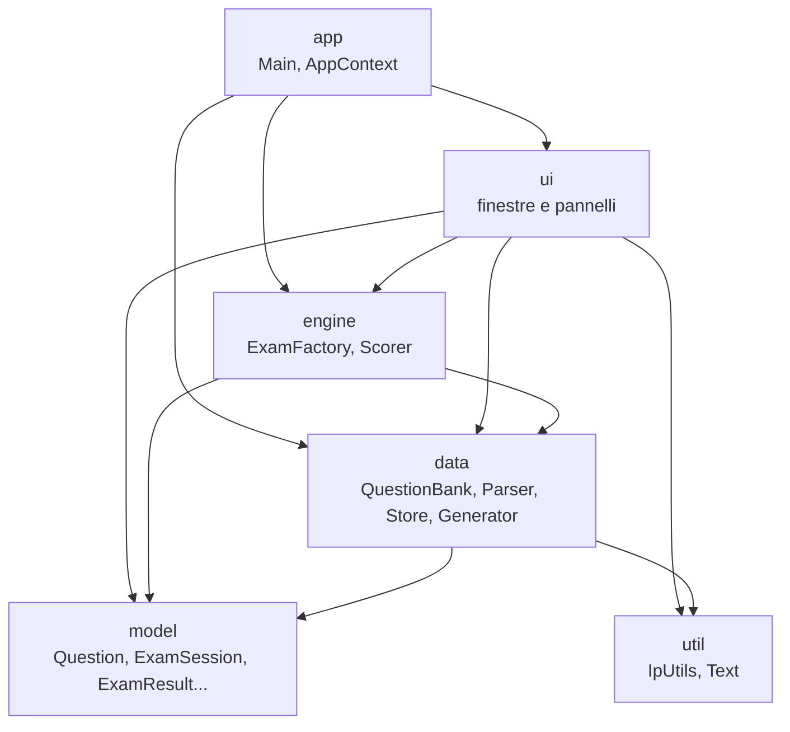
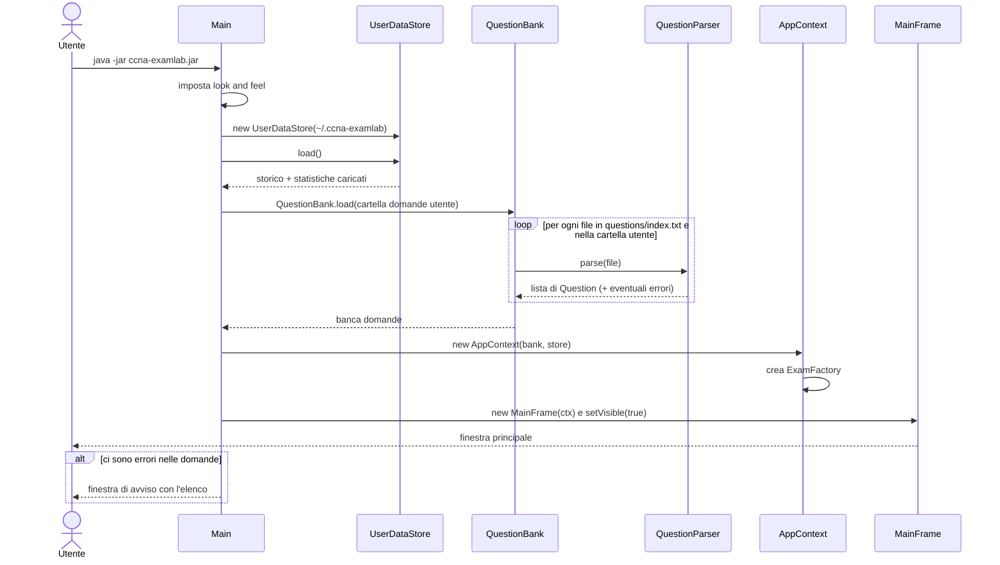
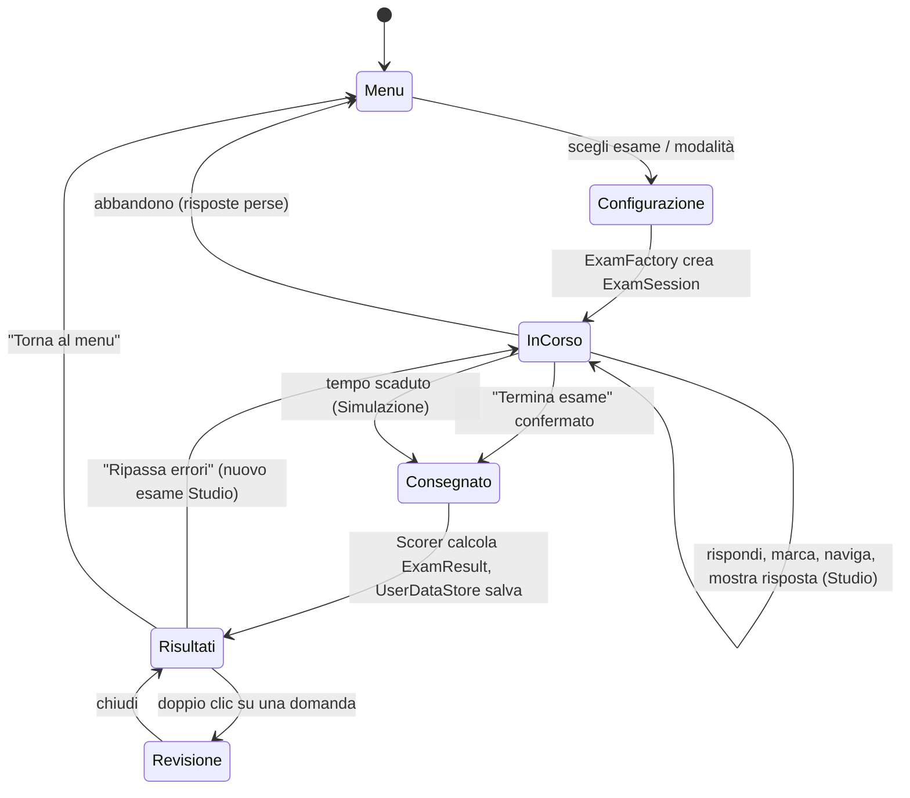
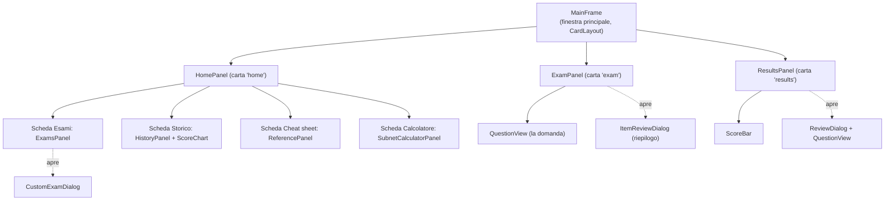
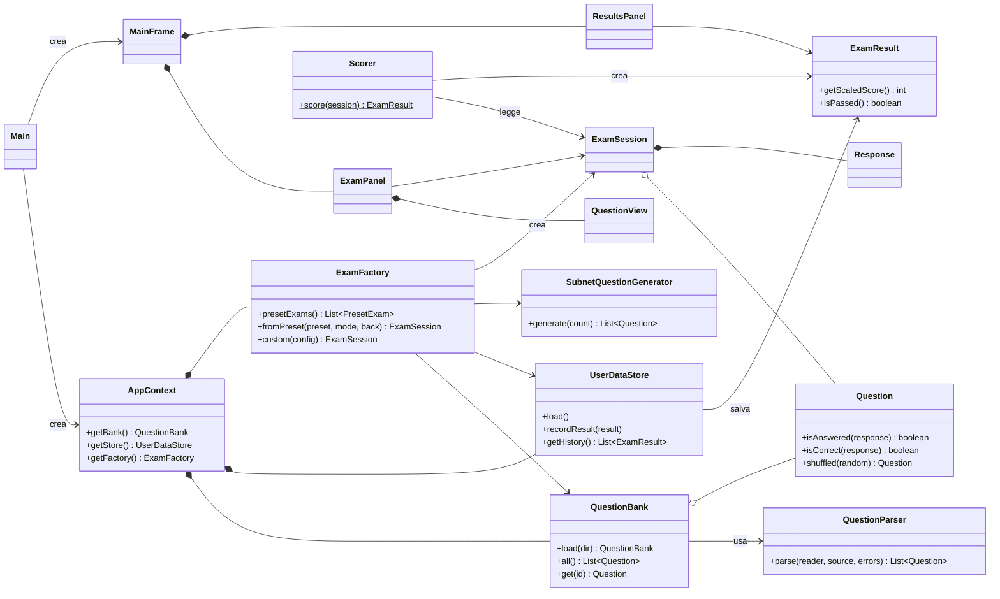

# 02 - Come funziona il programma

## 1. L'idea in una frase

CCNA ExamLab **legge un archivio di domande da file di testo**, **costruisce un esame** scegliendo le
domande con regole precise, **mostra le domande** una alla volta in una finestra, **corregge** le risposte,
**salva** il risultato e **mostra un report** per capire dove migliorare.

## 2. L'analogia del ristorante

Il programma è diviso in "reparti" (pacchetti), ognuno con un compito preciso, come in un ristorante:

| Reparto del ristorante | Pacchetto | Cosa fa |
|---|---|---|
| Il **menu** e i nomi dei piatti | `model` | definisce *cosa sono* domanda, risposta, esame, risultato. Non fa nulla da solo: è il vocabolario. |
| La **dispensa** e il fornitore | `data` | legge le domande dai file, inventa esercizi di subnetting, salva e rilegge lo storico. |
| La **cucina** | `engine` | prepara gli esami (sceglie le domande nelle giuste proporzioni) e li corregge. |
| La **sala** e i camerieri | `ui` | tutto ciò che vedi: finestre, pulsanti, tabelle, grafici. |
| Il **direttore** che apre il locale | `app` | avvia il programma e collega tra loro i reparti. |
| Gli **attrezzi** | `util` | strumenti generici: calcoli sugli indirizzi IP, formattazione dei testi. |

Regola d'oro: i reparti "alti" usano quelli "bassi", mai il contrario. La sala (`ui`) chiede piatti alla
cucina (`engine`), ma la cucina non sa nulla di come è fatta la sala. Così si può cambiare la grafica
senza toccare la logica, e viceversa.



## 3. Struttura dei file

```
src/main/java/com/ccnaexamlab/
├── app/      Main.java (punto di partenza), AppContext.java (servizi condivisi)
├── model/    Domain, QuestionType, ExamMode, Question, Response, ExamSession, DomainScore, ExamResult
├── data/     QuestionParser, QuestionParseException, QuestionBank, QuestionStat, UserDataStore,
│             SubnetQuestionGenerator
├── engine/   ExamConfig, QuestionFilter, PresetExam, ExamFactory, Scorer
├── ui/       MainFrame, HomePanel, ExamsPanel, HistoryPanel, ReferencePanel, SubnetCalculatorPanel,
│             CustomExamDialog, ExamPanel, QuestionView, ItemReviewDialog, ResultsPanel, ReviewDialog,
│             ScoreBar, ScoreChart, Ui, WrapLabel, ScrollablePanel
└── util/     IpUtils, Text

src/main/resources/
├── questions/   index.txt + 6 file .txt con le domande (uno per dominio)
└── reference/   index.txt + 12 pagine .html del cheat sheet
```

## 4. Cosa succede quando avvii il programma

**In parole semplici:** il programma apre la cartella dei tuoi dati personali (storico, statistiche),
legge tutte le domande dai file, controlla che siano scritte bene, prepara gli esami predefiniti e
mostra la finestra principale. Se qualche domanda ha errori di formato, te lo dice con un avviso ma
continua a funzionare con le altre.



Esiste anche una modalità senza finestra: `java -jar ccna-examlab.jar --validate` legge solo le domande
e stampa quante sono e gli eventuali errori (utile prima di pubblicare modifiche).

## 5. Il ciclo di vita di un esame



Passo per passo:

1. **Scelta.** Nel menu scegli un esame predefinito (A-D), un esame casuale, uno personalizzato, un drill
   di subnetting o un ripasso.
2. **Costruzione.** `ExamFactory` sceglie le domande, ne mescola l'ordine e l'ordine delle opzioni, e
   crea un oggetto `ExamSession` (l'esame "vivo", con lo spazio per le risposte).
3. **Svolgimento.** `ExamPanel` mostra una domanda alla volta tramite `QuestionView`; ogni clic aggiorna
   la `Response` corrispondente. Un timer conta i secondi.
4. **Consegna.** Alla fine `Scorer` confronta ogni risposta con quella corretta e produce un
   `ExamResult` (corrette, punteggio 300-1000, dettaglio per dominio).
5. **Salvataggio.** `UserDataStore` aggiunge una riga a `history.tsv` e aggiorna `stats.tsv`
   (quante volte hai visto/sbagliato/marcato ogni domanda).
6. **Report.** `ResultsPanel` mostra punteggio, barre per dominio e l'elenco domande; da qui puoi
   rivedere ogni domanda (`ReviewDialog`) o ripassare subito gli errori.

## 6. Dove vengono salvati i dati

| Dato | Dove | Formato | Chi lo scrive |
|---|---|---|---|
| Domande incluse | dentro il `.jar` (`/questions/*.txt`) | testo a blocchi `[Q]...[/Q]` | gli autori del progetto |
| Domande personali | `~/.ccna-examlab/questions/*.txt` | stesso formato | l'utente |
| Cheat sheet | dentro il `.jar` (`/reference/*.html`) | HTML | gli autori |
| Storico esami | `~/.ccna-examlab/history.tsv` | una riga per esame, campi separati da TAB | `UserDataStore.recordResult` |
| Statistiche domande | `~/.ccna-examlab/stats.tsv` | una riga per domanda | `UserDataStore.saveStats` |

`~` è la cartella personale dell'utente (es. `C:\Users\Mario` su Windows, `/home/mario` su Linux).
La posizione si può cambiare avviando con `-Dccna.examlab.home=/altro/percorso`.

## 7. Le schermate e le classi che le disegnano



## 8. Diagramma UML generale (semplificato)

Il diagramma mostra le classi principali e come sono collegate. I dettagli di ogni classe sono nei
capitoli 03-07.



## 9. Principi di progettazione usati (e perché)

| Principio | Dove | Perché è utile |
|---|---|---|
| **Separazione dei compiti** | pacchetti `model`/`data`/`engine`/`ui` | si può cambiare un pezzo senza rompere gli altri |
| **Oggetti immutabili** | `Question`, `PresetExam`, `ExamResult` | una domanda non può essere modificata per errore durante un esame |
| **Builder** | `Question.Builder`, `ExamConfig` | crea oggetti con molti campi in modo leggibile e con controlli di validità |
| **Dati fuori dal codice** | domande `.txt`, cheat sheet `.html` | per aggiungere domande non serve programmare né ricompilare (cartella utente) |
| **Nessuna libreria esterna** | tutto il progetto | si compila con il solo JDK, niente da scaricare, niente dipendenze che invecchiano |
| **Tolleranza agli errori** | parser, caricamento storico | una domanda o una riga rovinata non blocca tutto il programma |
