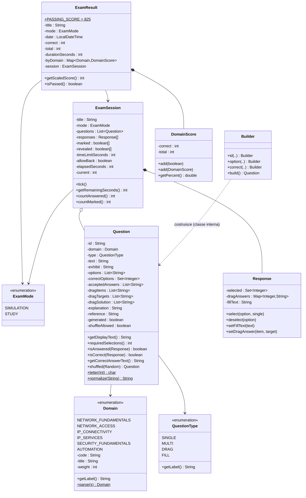

# 03 - Pacchetto `model`: il vocabolario del programma

Il pacchetto `model` definisce **che cosa sono** le cose di cui parla il programma: un dominio d'esame,
una domanda, una risposta, un esame in corso, un risultato. Queste classi **non disegnano nulla e non
leggono file**: sono come i moduli prestampati che gli altri reparti compilano e si passano.



---

## `Domain` — i sei argomenti dell'esame

**Cos'è, in parole semplici.** È l'elenco fisso dei sei "capitoli" del programma ufficiale CCNA
(blueprint v1.1). Per ognuno ricorda tre cose: il codice ("1.0"), il nome inglese
("Network Fundamentals") e quanto pesa sull'esame reale (20%).

**Perché un `enum`.** I domini sono sempre e solo sei: un `enum` impedisce di inventarne uno inesistente
per errore di battitura.

| Elemento | Descrizione |
|---|---|
| valori | `NETWORK_FUNDAMENTALS` (1.0, 20%), `NETWORK_ACCESS` (2.0, 20%), `IP_CONNECTIVITY` (3.0, 25%), `IP_SERVICES` (4.0, 10%), `SECURITY_FUNDAMENTALS` (5.0, 15%), `AUTOMATION` (6.0, 10%) |
| `getCode()` / `getTitle()` / `getWeight()` | restituiscono codice, nome e peso |
| `getLabel()` | "1.0 Network Fundamentals", usata in tutte le tabelle |
| `parse(String)` | trasforma il testo scritto nei file delle domande nel dominio giusto. Accetta tre forme: il nome (`NETWORK_ACCESS`), il numero (`2`) o il codice (`2.0`). Se non trova nulla lancia un errore che il parser trasforma in un avviso. |
| `toString()` | come `getLabel()`: così i menu a tendina mostrano un nome leggibile |

**Chi la usa:** quasi tutti. È la "chiave" per raggruppare domande e punteggi.

---

## `QuestionType` — i quattro tipi di domanda

| Valore | Etichetta | Come si risponde |
|---|---|---|
| `SINGLE` | Risposta singola | un pallino (radio button) |
| `MULTI` | Risposta multipla | più caselle ("Choose two") |
| `DRAG` | Drag and drop | menu a tendina per abbinare elementi a categorie |
| `FILL` | Risposta aperta | campo di testo (es. un indirizzo IP calcolato) |

`getLabel()` restituisce l'etichetta in italiano mostrata nell'interfaccia.

---

## `ExamMode` — le due modalità

| Valore | Etichetta | Comportamento |
|---|---|---|
| `SIMULATION` | Simulazione | timer con limite, nessuna spiegazione fino alla consegna |
| `STUDY` | Studio | nessun limite, pulsante "Mostra risposta" |

---

## `Question` — una domanda d'esame

**Cos'è, in parole semplici.** È la "scheda" di una domanda: il testo, l'eventuale exhibit (l'output di
un comando mostrato in nero), le opzioni, la risposta giusta, la spiegazione e il riferimento al
programma d'esame. Sa anche fare tre cose importanti:

1. dire se una risposta è **completa** (`isAnswered`);
2. dire se una risposta è **giusta** (`isCorrect`);
3. creare una **copia con le opzioni mescolate** (`shuffled`).

**È immutabile.** Una volta creata non si può più modificare: tutti i campi sono `final` e le liste
vengono copiate in versioni non modificabili (`List.copyOf`). Così nessuna parte del programma può
"rovinare" una domanda per sbaglio durante un esame.

**Come si crea: il Builder.** Il costruttore è `private`: l'unico modo per creare una domanda è usare
la classe interna `Question.Builder`, che raccoglie i pezzi uno alla volta e alla fine, con `build()`,
**controlla che la domanda sia coerente** (vedi sotto) e solo allora la crea.

```java
Question q = new Question.Builder()
    .id("NF-008").domain(Domain.NETWORK_FUNDAMENTALS).type(QuestionType.FILL)
    .text("How many usable host addresses are available in a /27 subnet?")
    .accept("30")
    .build();
```

### Campi

| Campo | Significato | Usato da |
|---|---|---|
| `id` | identificativo unico (es. `IPC-001`), anche chiave delle statistiche | tutti |
| `domain`, `type` | dominio e tipo | engine, ui |
| `text` | testo della domanda | `QuestionView` |
| `exhibit` | testo monospazio (output CLI, JSON…), può essere vuoto | `QuestionView` |
| `options` | testi delle opzioni A, B, C… (SINGLE/MULTI) | `QuestionView` |
| `correctOptions` | posizioni (0 = A) delle opzioni corrette, ordinate | correzione |
| `acceptedAnswers` | risposte accettate per FILL (es. `192.168.10.64` e `192.168.10.64/26`) | correzione |
| `dragItems` | elementi da abbinare (colonna sinistra) | DRAG |
| `dragSolution` | per ogni elemento, la categoria giusta (stessa posizione) | DRAG |
| `dragTargets` | elenco delle categorie mostrate nei menu: quelle corrette senza doppioni + eventuali "distrattori" | DRAG |
| `explanation`, `reference` | spiegazione e riferimento al blueprint | revisione |
| `generated` | `true` per le domande inventate dal generatore di subnetting (non vengono salvate nelle statistiche) | `UserDataStore` |
| `shuffleAllowed` | se si possono mescolare le opzioni (falso con `shuffle: no`) | `shuffled` |
| `source` | nome del file da cui proviene (per i messaggi di errore) | `QuestionBank` |

### Metodi

| Metodo | Cosa fa, in parole semplici |
|---|---|
| `requiredSelections()` | quante opzioni vanno selezionate (= quante sono corrette) |
| `getDisplayText()` | il testo da mostrare; per le MULTI aggiunge "(Choose two.)" se l'autore non l'ha scritto |
| `isAnswered(r)` | SINGLE: 1 opzione scelta; MULTI: esattamente N opzioni; FILL: testo non vuoto; DRAG: tutti gli elementi abbinati |
| `isCorrect(r)` | correzione "tutto o niente": SINGLE/MULTI l'insieme scelto deve essere *identico* a quello giusto; FILL il testo normalizzato deve coincidere con una delle risposte accettate; DRAG ogni elemento deve avere la categoria giusta |
| `getCorrectAnswerText()` | la risposta giusta in forma leggibile ("B, D" oppure "OSPF → 110 …") |
| `shuffled(random)` | crea una nuova domanda identica ma con le opzioni in ordine casuale, ricalcolando le posizioni corrette (vedi [algoritmo 6](08-algoritmi.md#6-mescolamento-delle-opzioni)) |
| `letter(i)` (statico) | 0 → 'A', 1 → 'B'… (aritmetica sui caratteri: `'A' + i`) |
| `normalize(s)` (statico) | toglie spazi all'inizio/fine, mette in minuscolo e riduce gli spazi multipli a uno: così "  192.168.1.0 " = "192.168.1.0" |

### Controlli di validità in `Builder.build()`

| Tipo | Controllo | Messaggio |
|---|---|---|
| tutti | `id`, `domain`, `type`, `text` presenti | "id mancante", "text mancante"… |
| SINGLE/MULTI | almeno 2 opzioni | "servono almeno 2 opzioni" |
| SINGLE/MULTI | ogni risposta corrisponde a un'opzione esistente | "risposta fuori dalle opzioni" |
| SINGLE | esattamente 1 risposta | "SINGLE richiede esattamente 1 risposta" |
| MULTI | almeno 2 risposte | "MULTI richiede almeno 2 risposte" |
| FILL | almeno una risposta accettata | "FILL richiede almeno una risposta" |
| DRAG | almeno 2 elementi | "DRAG richiede almeno 2 elementi" |

---

## `Response` — la risposta dell'utente a una domanda

**Cos'è.** Il "foglio risposte" di una singola domanda. Ha tre scomparti, ognuno usato da un tipo di
domanda:

| Campo | Tipo | Per |
|---|---|---|
| `selected` | insieme ordinato (`TreeSet`) di posizioni scelte | SINGLE, MULTI |
| `dragAnswers` | mappa *posizione elemento → categoria scelta* | DRAG |
| `fillText` | testo digitato | FILL |

| Metodo | Effetto |
|---|---|
| `select(option, single)` | aggiunge l'opzione; se `single` è vero prima svuota le altre (comportamento del pallino) |
| `deselect(option)` | toglie l'opzione (casella deselezionata) |
| `setFillText(text)` | memorizza il testo (mai `null`: diventa stringa vuota) |
| `setDragAnswer(item, target)` | memorizza l'abbinamento; se il target è vuoto lo rimuove |
| `dragAnswerCount()` | quanti elementi sono stati abbinati |
| `getSelected()` | restituisce una vista **in sola lettura** delle scelte, per evitare modifiche "dall'esterno" |

---

## `ExamSession` — l'esame in corso

**Cos'è.** L'esame "vivo": le domande nell'ordine in cui verranno mostrate, una `Response` per ogni
domanda, quali sono marcate, quali hanno già la risposta rivelata (modalità Studio), il tempo trascorso e
la domanda corrente.

**Perché array.** Le risposte, le marcature e le rivelazioni sono **array** della stessa lunghezza della
lista di domande: la domanda in posizione 7 ha la risposta in `responses[7]`, la marcatura in
`marked[7]` e così via. Semplice e veloce.

| Metodo | Cosa fa |
|---|---|
| costruttore | rifiuta un esame vuoto; copia la lista domande; crea una `Response` vuota per ogni domanda |
| `getQuestion(i)`, `getResponse(i)` | domanda e risposta numero *i* |
| `isMarked/setMarked`, `isRevealed/setRevealed` | marcatura e "risposta mostrata" |
| `isTimed()` | vero se c'è un limite di tempo (> 0) |
| `tick()` | aggiunge 1 secondo al tempo trascorso (lo chiama il timer dell'`ExamPanel`) |
| `getRemainingSeconds()` | limite − trascorso, mai negativo |
| `isAllowBack()` | se si può tornare indietro (falso = come l'esame Cisco) |
| `setCurrent(i)` | cambia domanda corrente, ignorando indici fuori range |
| `isAnswered(i)`, `countAnswered()`, `countMarked()` | contatori per barra di avanzamento e conferma finale |

---

## `DomainScore` — punteggio parziale per un dominio

Due contatori: `correct` e `total`. `add(boolean ok)` registra una domanda (incrementa `total` e, se
giusta, `correct`); `add(DomainScore altro)` somma due punteggi (usato per lo storico complessivo);
`getPercent()` calcola la percentuale evitando la divisione per zero.

---

## `ExamResult` — il risultato di un esame concluso

**Cos'è.** Il "verbale" dell'esame: titolo, modalità, data, corrette, totale, durata, dettaglio per
dominio. Contiene anche il riferimento alla `ExamSession` **solo** per l'esame appena svolto (serve alla
revisione); i risultati riletti dallo storico hanno `session = null`.

| Costante | Valore | Significato |
|---|---|---|
| `MIN_SCORE` | 300 | punteggio minimo della scala Cisco |
| `MAX_SCORE` | 1000 | punteggio massimo |
| `PASSING_SCORE` | 825 | soglia di superamento usata dal programma (stima prudente: Cisco non la pubblica) |

| Metodo | Cosa fa |
|---|---|
| `getPercent()` | percentuale di risposte corrette |
| `getScaledScore()` | converte la percentuale nella scala 300-1000: `300 + 700 × (corrette / totale)`, arrotondato. Es. 60/75 = 80% → 300 + 560 = **860** |
| `isPassed()` | punteggio ≥ 825 (corrisponde al 75% di risposte corrette) |
| `getByDomain()` | mappa ordinata dominio → `DomainScore` (`EnumMap` mantiene l'ordine 1.0 → 6.0) |
