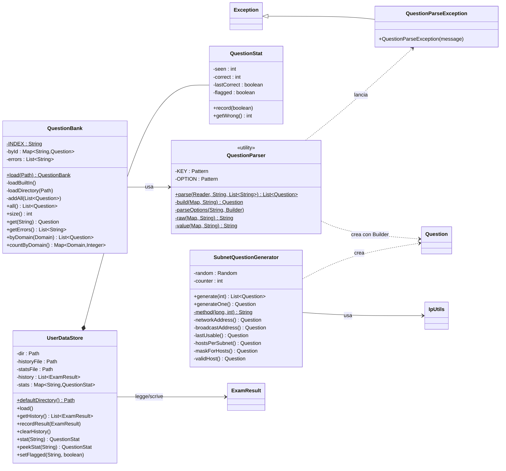

# 04 - Pacchetto `data`: leggere, generare e salvare

Il pacchetto `data` è la "dispensa": si occupa di **procurare** le domande (leggendole dai file o
inventandole) e di **conservare** i risultati dell'utente su disco.



---

## `QuestionParser` — chi legge i file delle domande

**In parole semplici.** I file delle domande sono testi scritti a mano con un formato a blocchi:

```text
[Q]
id: NF-001
domain: 1
type: SINGLE
text:
At which layer of the OSI model...
options:
A) Layer 1 - Physical
B) Layer 2 - Data Link
answer: B
explanation:
Uno switch (Layer 2)...
[/Q]
```

Il parser legge il file **riga per riga** come farebbe una persona con un evidenziatore:
- quando vede `[Q]` apre una "scheda nuova";
- quando vede una riga che inizia con una parola chiave seguita da due punti (`text:`, `options:`…)
  inizia a riempire quello "scomparto" della scheda;
- le righe successive senza parola chiave vengono aggiunte allo scomparto aperto (così un testo può
  stare su più righe);
- quando vede `[/Q]` chiude la scheda e la trasforma in un oggetto `Question`.

Se una scheda è sbagliata (es. manca la risposta) **non si ferma**: annota l'errore nella lista
`errors` (con nome del file e riga) e passa alla successiva.

| Elemento | Descrizione |
|---|---|
| `KEY` | espressione regolare che riconosce le parole chiave valide a inizio riga: `id, domain, type, text, exhibit, options, answer, explanation, reference, items, targets, shuffle` |
| `OPTION` | riconosce le righe delle opzioni: una lettera, poi `)` o `.`, poi spazio (es. `B) testo`) |
| costruttore privato | la classe ha solo metodi statici: non ha senso crearne oggetti |
| `parse(reader, source, errors)` | il ciclo principale descritto sopra ([flowchart](08-algoritmi.md#1-lettura-dei-file-delle-domande-parser)) |
| `build(fields, source)` | trasforma la mappa "scomparto → testo" in una `Question`: legge id, dominio, tipo, testi; poi, secondo il tipo, interpreta `answer` (lettere per SINGLE/MULTI, alternative separate da `\|` per FILL) o `items` (`elemento => categoria` per DRAG) |
| `parseOptions(block, builder)` | divide il blocco `options:` in opzioni; una riga che non inizia con una lettera continua l'opzione precedente |
| `raw` / `value` | leggono uno scomparto, rispettivamente così com'è o senza spazi agli estremi |

**Perché le parole chiave devono stare a inizio riga (colonna 0).** Così un exhibit che contiene ad
esempio `  "id": 5` (indentato) non viene scambiato per il campo `id:`.

---

## `QuestionParseException`

Un tipo di errore dedicato ("eccezione") che il parser usa internamente per dire "questa scheda è
sbagliata, ecco perché". Viene sempre intercettato e trasformato in una riga della lista errori.

---

## `QuestionBank` — l'archivio di tutte le domande

**In parole semplici.** È lo schedario: carica tutte le domande una volta all'avvio e poi risponde a
domande come "dammi tutte le domande del dominio 3" o "dammi la domanda IPC-001".

**Da dove carica:**
1. **Domande incluse nel programma**: legge `/questions/index.txt` (dentro il `.jar`), che elenca i file
   da caricare, e li passa uno a uno al parser. Serve un indice perché dentro un `.jar` non è semplice
   "elencare i file di una cartella".
2. **Domande dell'utente**: tutti i file `*.txt` in `~/.ccna-examlab/questions/`.

**ID duplicati.** Se due domande hanno lo stesso ID, tiene la prima e segnala l'altra come errore.

| Metodo | Cosa fa |
|---|---|
| `load(dir)` (statico) | crea la banca, carica le domande incluse e poi quelle della cartella utente |
| `all()` | copia della lista di tutte le domande (nell'ordine di caricamento) |
| `size()` | quante domande |
| `get(id)` | la domanda con quell'ID, o `null` |
| `byDomain(d)` | nuova lista con le sole domande del dominio `d` |
| `countByDomain()` | quante domande per dominio (usato da `--validate` e dalla home) |
| `getErrors()` | elenco in sola lettura degli errori di caricamento |

Struttura interna: una `LinkedHashMap` che associa ID → domanda e **ricorda l'ordine di inserimento**.

---

## `QuestionStat` — la "pagella" di una singola domanda

| Campo | Significato |
|---|---|
| `seen` | quante volte è comparsa in un esame consegnato |
| `correct` | quante volte hai risposto bene |
| `lastCorrect` | se l'ultima volta l'hai azzeccata (serve al filtro "sbagliate l'ultima volta") |
| `flagged` | se l'hai marcata almeno una volta |

`record(ok)` aggiorna i contatori dopo un esame; `getWrong()` = `seen - correct`.

---

## `UserDataStore` — il magazzino dei dati personali

**In parole semplici.** Ricorda **tutto quello che hai fatto**: gli esami svolti e come sei andato su ogni
domanda. Lavora sulla cartella `~/.ccna-examlab/`, con due file di testo semplici (apribili anche con
Excel o il Blocco note).

**Formato di `history.tsv`** (una riga per esame, campi separati da TAB):

```
2026-11-05T12:08:22  Esame A  SIMULATION  60  75  4120  NETWORK_FUNDAMENTALS:14/15;NETWORK_ACCESS:12/15;...
   data e ora        titolo   modalità   ok  tot  sec   dettaglio per dominio
```

**Formato di `stats.tsv`**:

```
# id    seen  correct  lastCorrect  flagged
NF-001  3     2        true         false
```

| Metodo | Cosa fa |
|---|---|
| costruttore | memorizza i percorsi della cartella e dei due file (non legge ancora nulla) |
| `defaultDirectory()` | `~/.ccna-examlab`, oppure il percorso indicato con `-Dccna.examlab.home=...` |
| `load()` | crea la cartella (e `questions/`) se non esiste, poi legge storico e statistiche. Le righe illeggibili vengono saltate con un messaggio sulla console, senza bloccare il programma |
| `recordResult(result)` | aggiunge il risultato allo storico in memoria **e** in coda al file (`APPEND`, senza riscriverlo); poi per ogni domanda non generata aggiorna `QuestionStat` (vista, giusta/sbagliata, marcata) e riscrive `stats.tsv` ([flowchart](08-algoritmi.md#8-salvataggio-del-risultato)) |
| `clearHistory()` | svuota tutto e cancella i due file (pulsante "Azzera storico") |
| `stat(id)` | restituisce la statistica, creandola se manca |
| `peekStat(id)` | restituisce la statistica o `null` **senza crearla** (per sola lettura) |
| `setFlagged(id, v)` | imposta la marcatura persistente e salva |
| `parseHistoryLine` / `toHistoryLine` (privati) | convertono tra una riga di testo e un `ExamResult` |

**Perché TSV e non un database.** Zero librerie esterne, file leggibili e modificabili a mano, backup
semplice (basta copiare la cartella).

---

## `SubnetQuestionGenerator` — la fabbrica di esercizi di subnetting

**In parole semplici.** Invece di leggere domande già scritte, ne **inventa** di nuove ogni volta:
sceglie un prefisso (es. /26) e un indirizzo IP privato a caso, calcola la soluzione con `IpUtils` e
scrive anche la spiegazione passo-passo con il metodo del *magic number*.

Le sei varianti (scelte a caso con `random.nextInt(6)`):

| Metodo | Domanda | Tipo | Prefissi |
|---|---|---|---|
| `networkAddress()` | Qual è l'indirizzo di rete di host X/p? | FILL (accetta anche "rete/p") | /17-/30 |
| `broadcastAddress()` | Qual è il broadcast (dati IP e maschera)? | FILL | /17-/30 |
| `lastUsable()` | Qual è l'ultimo host utilizzabile? | FILL | /20-/30 |
| `hostsPerSubnet()` | Quanti host utilizzabili con questa maschera/prefisso? | FILL | /18-/30 |
| `maskForHosts()` | Quale maschera per N host sprecando meno indirizzi? | SINGLE (4 opzioni) | /20-/29 |
| `validHost()` | Quale indirizzo è un host valido della subnet? | SINGLE (host, rete, broadcast, altra subnet) | /24-/29 |

| Elemento di supporto | Cosa fa |
|---|---|
| `counter` | numera le domande generate: ID `GEN-SUB-0001`, `GEN-SUB-0002`… |
| `randomPrefix(min, max)` | numero intero casuale tra min e max inclusi |
| `randomIp(prefix)` | indirizzo privato casuale (10.x, 172.16-31.x o 192.168.x per prefissi ≥ /24) che sia un **host valido** (né rete né broadcast) |
| `base(type)` | prepara un `Builder` già compilato con ID, dominio 1.0, tipo, `generated=true`, riferimento |
| `method(ip, prefix)` | scrive la spiegazione col metodo del magic number ([algoritmo 7](08-algoritmi.md#7-generatore-di-subnetting-e-metodo-del-magic-number)) |

Le domande generate hanno `generated = true`: non entrano nelle statistiche per-domanda (cambiano ogni
volta, non avrebbe senso), ma contano nel punteggio dell'esame.
