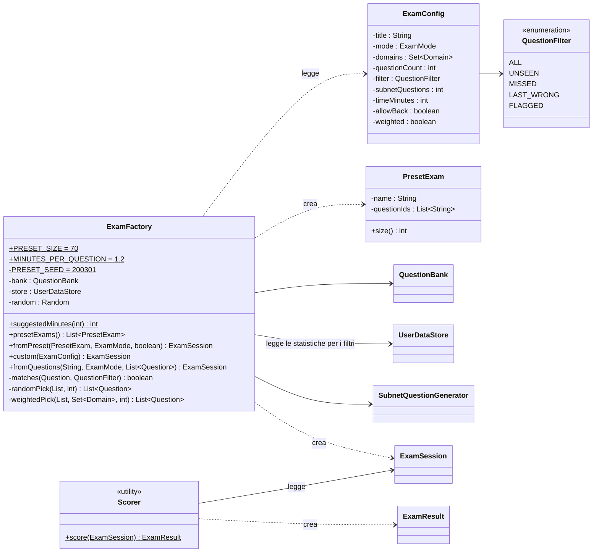
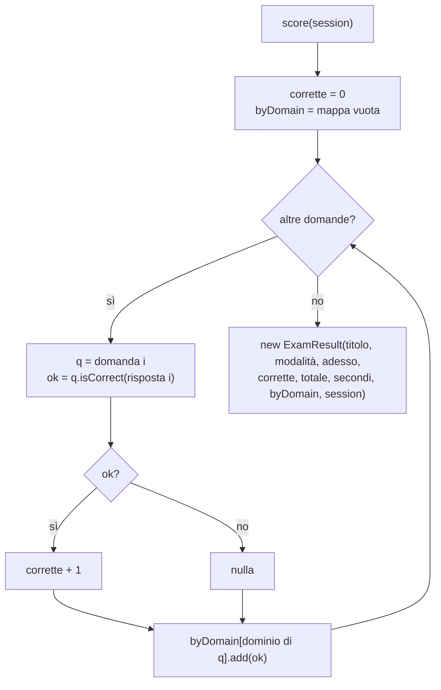

# 05 - Pacchetto `engine`: preparare e correggere gli esami

Il pacchetto `engine` è la "cucina": prende le domande dall'archivio e **prepara gli esami** secondo
le regole scelte, poi li **corregge**.

---

## `ExamConfig` — la "comanda" dell'esame personalizzato

**In parole semplici.** È il modulo che compili nella finestra "Esame personalizzato": quali domini,
quante domande, quale filtro, quanto tempo… `ExamFactory` lo legge per preparare l'esame.

| Campo | Default | Significato |
|---|---|---|
| `title` | "Esame personalizzato" | nome mostrato in alto e nello storico |
| `mode` | `STUDY` | Simulazione o Studio |
| `domains` | tutti e sei | domini da cui pescare |
| `questionCount` | 30 | quante domande dalla banca |
| `filter` | `ALL` | quali domande considerare (vedi `QuestionFilter`) |
| `subnetQuestions` | 0 | quante domande di subnetting generate aggiungere |
| `timeMinutes` | 0 | minuti a disposizione (0 = senza limite) |
| `allowBack` | `true` | se si può tornare indietro |
| `weighted` | `true` | se distribuire le domande secondo i pesi del blueprint |

**Stile "fluente".** Ogni metodo di impostazione restituisce l'oggetto stesso (`return this`), così si
possono concatenare: `new ExamConfig().title("Drill").mode(ExamMode.STUDY).subnetQuestions(20)`.

---

## `QuestionFilter` — quali domande includere

| Valore | Etichetta | Include le domande… |
|---|---|---|
| `ALL` | Tutte le domande | tutte |
| `UNSEEN` | Solo domande mai viste | senza statistiche o con `seen = 0` |
| `MISSED` | Solo domande sbagliate almeno una volta | con `wrong > 0` |
| `LAST_WRONG` | Solo domande sbagliate l'ultima volta | viste e con `lastCorrect = false` |
| `FLAGGED` | Solo domande marcate | con `flagged = true` |

`toString()` restituisce l'etichetta, mostrata nel menu a tendina.

---

## `PresetExam` — un esame predefinito

Un nome ("Esame A") e la **lista degli ID** delle sue domande. Contiene solo gli ID (non le domande) così
è leggero e le domande vengono prese dalla banca al momento dell'avvio. È immutabile.

---

## `ExamFactory` — la cucina

**In parole semplici.** Riceve una richiesta ("voglio l'Esame A in simulazione", "voglio 30 domande di
sicurezza mai viste") e restituisce un `ExamSession` pronto da svolgere.

### Costanti

| Costante | Valore | Perché |
|---|---|---|
| `PRESET_SIZE` | 70 | dimensione indicativa di un esame predefinito; con 298 domande si ottengono 4 esami da ~75 |
| `MINUTES_PER_QUESTION` | 1,2 | l'esame reale dà 120 minuti per circa 100 domande |
| `PRESET_SEED` | 200301 | "seme" fisso del generatore casuale: la suddivisione degli esami predefiniti è sempre la stessa a ogni avvio (Esame A contiene sempre le stesse domande) |

### Metodi

| Metodo | Cosa fa, in parole semplici |
|---|---|
| `suggestedMinutes(n)` | minuti consigliati per *n* domande = n × 1,2 arrotondato per eccesso |
| `presetExams()` | divide **tutta** la banca in esami **disgiunti** (nessuna domanda in due esami), ciascuno con una distribuzione per dominio simile a quella reale ([algoritmo 3](08-algoritmi.md#3-suddivisione-negli-esami-predefiniti)) |
| `fromPreset(preset, mode, allowBack)` | recupera le domande del preset, **mescola le opzioni** di ognuna, imposta il tempo (solo in Simulazione) e crea la sessione |
| `custom(cfg)` | filtra la banca per domini e filtro, sceglie le domande (pesate o casuali), mescola le opzioni, aggiunge le domande generate, mescola l'ordine; restituisce `null` se non c'è nessuna domanda ([algoritmo 4](08-algoritmi.md#4-esame-personalizzato-e-selezione-pesata)) |
| `fromQuestions(title, mode, list)` | esame da una lista precisa (usato da "Ripassa errori" nel report) |
| `matches(q, filter)` (privato) | applica il filtro guardando le statistiche con `peekStat` |
| `randomPick(pool, n)` (privato) | prende *n* domande a caso |
| `weightedPick(pool, domains, n)` (privato) | prende le domande in proporzione ai pesi dei domini, riempiendo eventuali "buchi" con domande avanzate |

Nota sul campo `random`: è un `new Random()` **senza seme**, quindi esami casuali e mescolamenti cambiano
ogni volta. Solo la suddivisione in esami predefiniti usa il seme fisso.

---

## `Scorer` — il correttore

**In parole semplici.** Prende l'esame consegnato, guarda una domanda alla volta, chiede alla domanda
stessa "questa risposta è giusta?" (`Question.isCorrect`) e conta: quante giuste in totale e quante per
ogni dominio. Infine compila un `ExamResult` con la data e l'ora attuali.

La correzione è "tutto o niente" per ogni domanda (niente punteggio parziale sulle multiple), per
allenarsi nel modo più severo.
