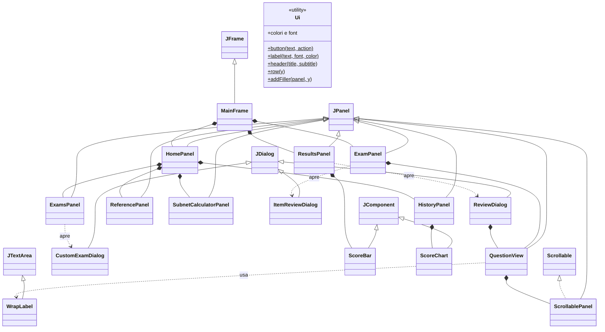

# 06 - Pacchetto `ui`: tutto ciò che vedi

Il pacchetto `ui` (*user interface*, interfaccia utente) contiene le finestre, i pannelli e i
componenti grafici. È costruito con **Swing** (vedi [concetti base §5](01-concetti-base.md#5-linterfaccia-grafica-swing)).

Regola seguita: le classi `ui` **non contengono logica d'esame**. Per creare un esame chiedono a
`ExamFactory`, per correggerlo a `Scorer`, per salvare a `UserDataStore`. Si limitano a mostrare dati e
a raccogliere i clic.

## Mappa delle classi



---

## Classi di base e di supporto

### `Ui` — la "cassetta degli attrezzi" grafica

**In parole semplici.** Raccoglie in un solo posto colori, caratteri e piccole funzioni per creare
componenti già "vestiti" nello stile del programma. Se vuoi cambiare il colore blu dell'intestazione
o la dimensione del testo, si fa qui, una volta sola.

| Elemento | Descrizione |
|---|---|
| Colori | `HEADER_BG` (blu scuro intestazioni), `ACCENT` (blu), `OK`/`OK_BG` (verde e verde chiaro), `KO`/`KO_BG` (rosso e rosa), `WARN` (arancio), `EXHIBIT_BG/FG` (sfondo nero e testo chiaro degli exhibit) |
| Font | `BASE` (15 pt), `BOLD`, `SMALL` (13), `TITLE` (22 grassetto), `HUGE` (44, il punteggio), `MONO` (monospazio per exhibit e IP) |
| `button(testo, azione)` | crea un pulsante in grassetto che esegue `azione` al clic |
| `label(testo, font, colore)` | crea un'etichetta |
| `padding(v, h)` | bordo vuoto (margine interno) |
| `titled(titolo)` | bordo con titolo (i riquadri "Esami predefiniti", "Altre modalità"…) |
| `header(titolo, sottotitolo)` | la fascia blu con il titolo in alto |
| `row(y)` | "istruzioni di posizionamento" GridBag per impilare un componente alla riga *y*, a tutta larghezza |
| `addFiller(pannello, y)` | aggiunge in fondo uno spazio elastico che spinge tutto in alto |
| `setAllFonts`, `pct` | cambia il font di un intero albero di componenti; formatta "82%" |

### `WrapLabel` — etichetta che va a capo

Swing non ha un'etichetta che va a capo automaticamente. `WrapLabel` usa un'area di testo
(`JTextArea`) resa **non modificabile, trasparente e senza bordo**, con l'a capo per parole attivo.
Così testi lunghi (domande, opzioni, spiegazioni) si adattano alla larghezza della finestra.

### `ScrollablePanel` — pannello che segue la larghezza della finestra

Un pannello che implementa l'interfaccia `Scrollable` dicendo alla barra di scorrimento: "segui la mia
**larghezza** (non serve scorrere in orizzontale), ma lasciami crescere in **altezza** (scorri in
verticale)". È il trucco che permette alle `WrapLabel` di andare a capo correttamente.
Definisce anche la velocità di scorrimento (20 pixel per scatto della rotella).

---

## Finestra principale e menu

### `MainFrame` — la finestra principale

**In parole semplici.** È la finestra con la barra del titolo. Al suo interno c'è un "mazzo di carte"
(`CardLayout`) e se ne vede una sola alla volta: **home**, **exam** (esame in corso), **results**
(report). Coordina i passaggi tra una carta e l'altra.

| Metodo | Cosa fa |
|---|---|
| costruttore | crea la `HomePanel`, la barra dei menu, imposta dimensioni (1240×840, minimo 980×680) e intercetta la chiusura della finestra |
| `buildMenu()` | menu **File** (Menu principale, Cartella dati utente, Esci) e **Aiuto** (Guida rapida, Informazioni) |
| `startExam(session)` | crea un `ExamPanel` per la sessione, lo aggiunge al mazzo e lo mostra |
| `finishExam(session)` (privato) | chiamato dall'`ExamPanel` alla consegna: fa correggere (`Scorer.score`), salva (`recordResult`), rimuove l'`ExamPanel`, crea e mostra il `ResultsPanel`, aggiorna la home |
| `retryWrong(lista)` | avvia un esame Studio con le domande sbagliate |
| `showHome()` | ferma un eventuale esame, aggiorna e mostra la home |
| `confirmAbort()` | chiede conferma prima di abbandonare un esame in corso |
| `exit()` | chiede conferma se c'è un esame in corso, poi chiude il programma |
| `HELP` | il testo della "Guida rapida" |

Il flusso completo è descritto nell'[algoritmo 10](08-algoritmi.md#10-navigazione-tra-le-schermate-mainframe).

### `HomePanel` — il menu principale

La fascia blu con il nome del programma e il numero di domande, più quattro **schede**: *Esami*
(`ExamsPanel`), *Storico e progressi* (`HistoryPanel`), *Cheat sheet* (`ReferencePanel`), *Calcolatore
subnet* (`SubnetCalculatorPanel`). `refresh()` aggiorna le prime due dopo ogni esame (tentativi, punteggi).

### `ExamsPanel` — la scheda "Esami"

**A sinistra: esami predefiniti.** Una tabella (Esame, Domande, Tempo, Tentativi, Miglior punteggio,
Ultimo) calcolata leggendo lo storico, due pulsanti (*Avvia in Simulazione*, *Avvia in Studio*) e la
casella "Consenti di tornare alle domande precedenti".

**A destra: altre modalità**, ciascuna con un pulsante e una descrizione:

| Pulsante | Metodo | Cosa crea |
|---|---|---|
| Esame completo casuale | `startFullRandom()` | 100 domande (o meno se la banca è piccola), pesate, Simulazione, tempo suggerito |
| Esame personalizzato… | `startCustom()` | apre `CustomExamDialog`; se nessuna domanda corrisponde avvisa |
| Drill di subnetting | `startSubnetDrill()` | 20 domande generate, Studio |
| Ripassa gli errori | `startFiltered(LAST_WRONG)` | tutte le domande sbagliate l'ultima volta, Studio |
| Ripassa le marcate | `startFiltered(FLAGGED)` | tutte le domande marcate, Studio |

Sotto c'è la tabella **"Copertura e accuratezza per dominio"** (`DomainModel`): per ogni dominio il
peso, quante domande ci sono, quante ne hai viste e la percentuale di risposte giuste.

Le due tabelle usano **modelli** (`PresetModel`, `DomainModel`, classi interne che estendono
`AbstractTableModel`): invece di riempire la tabella a mano, la tabella chiede al modello "quante righe
hai?" e "cosa c'è nella cella (r, c)?". Per aggiornarla basta `fireTableDataChanged()`.

In Studio il ritorno indietro è sempre consentito; in Simulazione dipende dalla casella.
Prima di una simulazione compare una conferma con numero di domande e minuti.

### `CustomExamDialog` — la finestra "Esame personalizzato"

A sinistra le caselle dei sei domini (con i pulsanti *Tutti* / *Nessuno*); a destra titolo, modalità,
filtro, numero di domande, domande di subnetting, minuti, e le caselle "pesi del blueprint" e "tornare
indietro".

- Cambiando numero di domande, subnetting o modalità, `updateMinutes()` ricalcola i minuti: 0 in Studio,
  `suggestedMinutes(n)` in Simulazione.
- `confirm()` verifica che sia selezionato almeno un dominio (o del subnetting), compila un `ExamConfig`
  e chiude. `getResult()` restituisce la configurazione o `null` se l'utente ha annullato.
- È una finestra **modale**: blocca la finestra principale finché non viene chiusa, così il codice che
  la apre può leggere il risultato subito dopo `setVisible(true)`.

### `HistoryPanel` — la scheda "Storico e progressi"

- **Tabella degli esami** (più recenti in alto, ordinabile cliccando sulle intestazioni): data, esame,
  modalità, corrette, punteggio, esito, durata.
- **Grafico** (`ScoreChart`) degli ultimi 30 punteggi.
- **Accuratezza complessiva per dominio**: somma i `DomainScore` di tutti gli esami e li mostra con barre
  colorate (verde ≥ 82,5%, arancio ≥ 60%, rosso sotto).
- Pulsante **Azzera storico e statistiche** (con conferma).

### `ScoreChart` — il grafico dei punteggi

Componente disegnato "a mano" (metodo `paintComponent`): griglia orizzontale ogni 100 punti da 300 a 1000,
linea tratteggiata verde della soglia 825, una spezzata blu che unisce i punteggi e un pallino verde o
rosso per ogni esame. Se non ci sono esami scrive un messaggio. La conversione da punteggio a pixel è:
`y = alto + altezza − (punteggio − 300) / 700 × altezza`.

### `ReferencePanel` — la scheda "Cheat sheet"

Legge `/reference/index.txt` (righe `file.html|Titolo`), mostra i titoli in una lista a sinistra e,
quando ne selezioni uno, carica la pagina HTML corrispondente nel visualizzatore a destra
(`JEditorPane`). Lo stile (colori delle tabelle, riquadri "tip") è definito con regole CSS aggiunte
all'`HTMLEditorKit`.

### `SubnetCalculatorPanel` — la scheda "Calcolatore subnet"

Accetta `10.1.2.3/20` oppure `10.1.2.3 255.255.240.0`, e mostra in una tabella: indirizzo, prefisso e
maschera, wildcard, rete, broadcast, primo/ultimo host, host utilizzabili, indirizzi totali, magic number,
classe, se è privato, rappresentazione binaria di indirizzo e maschera. Gli errori di input vengono
mostrati in rosso accanto al pulsante. Tutti i calcoli sono fatti da `IpUtils`.

---

## Svolgimento dell'esame

### `ExamPanel` — lo schermo dell'esame

**In parole semplici.** È la "sala d'esame": in alto titolo, numero della domanda e cronometro; sotto,
la casella per marcare la domanda, la barra di avanzamento e (in Studio) il dominio; al centro la
domanda; in basso i pulsanti.

```
┌──────────────────────────────────────────────────────────────────┐
│ Esame A — Simulazione        Domanda 5 di 75          ⏱ 1:23:10  │  ← barra superiore
│ ☐ Marca per revisione  [██████░░░░ 4/75 risposte]  Tipo domanda  │  ← sottobarra
├──────────────────────────────────────────────────────────────────┤
│                     QuestionView (la domanda)                    │
├──────────────────────────────────────────────────────────────────┤
│ [Termina] [Riepilogo] [Mostra risposta]     [◀ Precedente] [Successiva ▶] │
└──────────────────────────────────────────────────────────────────┘
```

| Metodo | Cosa fa |
|---|---|
| costruttore | costruisce le tre fasce, nasconde *Precedente* e *Riepilogo* se non si può tornare indietro, registra le scorciatoie, avvia il timer, mostra la domanda 0 |
| `installKeys()` / `bind()` | Alt+→ successiva, Alt+← precedente, Ctrl+M marca, Ctrl+R mostra risposta (solo Studio) |
| `go(i)` | mostra la domanda *i*: aggiorna `QuestionView` (modificabile se non rivelata), casella marca, contatore, pulsanti; l'ultimo pulsante diventa "Fine ▶" |
| `next()` | passa alla successiva; se non si può tornare indietro e la risposta è incompleta chiede conferma; sull'ultima domanda propone la consegna |
| `revealCurrent()` | (Studio) segna la domanda come rivelata e la ridisegna con correzione e spiegazione: da quel momento non è più modificabile |
| `refreshStatus()` | aggiorna barra di avanzamento e informazioni sul tipo/dominio; è chiamato a ogni modifica di risposta |
| `openItemReview()` | apre il riepilogo e poi salta alla domanda scelta o avvia la consegna |
| `tick()` / `updateTimer()` | ogni secondo: +1 al tempo, aggiorna il cronometro (conto alla rovescia in Simulazione, rosa negli ultimi 5 minuti); a tempo scaduto avvisa e consegna |
| `confirmEnd()` | conferma la consegna ricordando domande incomplete e marcate |
| `finish()` | ferma il timer e passa la sessione a `MainFrame` (una sola volta, grazie al flag `finished`) |
| `abort()` | ferma il timer senza consegnare (abbandono) |

Dettagli nell'[algoritmo 9](08-algoritmi.md#9-svolgimento-dellesame-navigazione-timer-e-consegna).

### `QuestionView` — il disegno di una domanda

**In parole semplici.** Riceve una domanda e la relativa risposta e "impagina" tutto: testo,
exhibit nero in stile terminale, area di risposta adatta al tipo e, se richiesto, il riquadro con la
correzione. Ogni volta che l'utente tocca qualcosa aggiorna la `Response` e avvisa chi l'ha creata
(`onChange`).

| Metodo | Cosa fa |
|---|---|
| `display(q, r, modificabile, rivela)` | svuota il pannello e lo ricostruisce da zero per la domanda indicata; riporta lo scorrimento in cima |
| `exhibit(testo)` | riquadro nero con testo monospazio; scorre in orizzontale se le righe sono lunghe (la sua altezza è calcolata per mostrare tutte le righe) |
| `buildChoices(...)` | SINGLE: pallini in un `ButtonGroup` (uno solo selezionabile); MULTI: caselle + suggerimento "Seleziona N risposte". Cliccare sul testo dell'opzione equivale a cliccare il pallino. In revisione colora di verde le corrette e di rosa le scelte sbagliate |
| `buildDrag(...)` | per ogni elemento un'etichetta e un menu a tendina con le categorie; in revisione ✔ o "✘ → risposta giusta" |
| `buildFill(...)` | campo di testo; ogni carattere digitato aggiorna la risposta (`DocumentListener`); in revisione sfondo verde/rosa |
| `feedback(q, r)` | il riquadro finale: esito, risposta corretta, spiegazione, riferimento, ID/dominio/tipo |
| `plain(s)` | toglie i simboli `` ` `` e `**` dalla spiegazione (qui il testo è semplice, non HTML) |

### `ItemReviewDialog` — il riepilogo delle domande

Tabella con numero, stato (Risposta data / Incompleta in rosso), marcata (arancio) e, in Studio, il
dominio. Doppio clic o *Vai alla selezionata* per saltare a una domanda; *Prima incompleta* e *Prima
marcata* per trovare velocemente cosa manca; *Termina esame*. Chi l'ha aperta legge poi
`getSelectedIndex()` e `isEndRequested()`.

---

## Dopo l'esame

### `ResultsPanel` — il report

- **Intestazione**: titolo, SUPERATO/NON SUPERATO, corrette/totale/percentuale/tempo, il punteggio in
  grande e la `ScoreBar` con la soglia, più una nota che spiega che la soglia è una stima.
- **A sinistra**: una barra per dominio con peso, corrette/totale e colore.
- **A destra**: l'elenco delle domande con filtro (*Tutte*, *Solo errate / incomplete*, *Solo corrette*,
  *Solo marcate*); doppio clic apre la revisione.
- **In basso**: *Ripassa errori in modalità Studio* e *Torna al menu principale*.

Internamente la lista `visible` contiene gli indici delle domande che passano il filtro; il modello della
tabella (`QuestionsModel`) legge da lì.

### `ReviewDialog` — la revisione domanda per domanda

Finestra con una `QuestionView` in modalità "sola lettura + correzione" e i pulsanti *Precedente* /
*Successiva* che scorrono **solo** le domande del filtro scelto nel report.

### `ScoreBar` — la barra del punteggio

Componente disegnato a mano: barra grigia di sfondo, parte riempita (verde se superato, rossa altrimenti)
proporzionale a `(punteggio − 300) / 700`, linea tratteggiata verticale sulla soglia 825 con l'etichetta.
