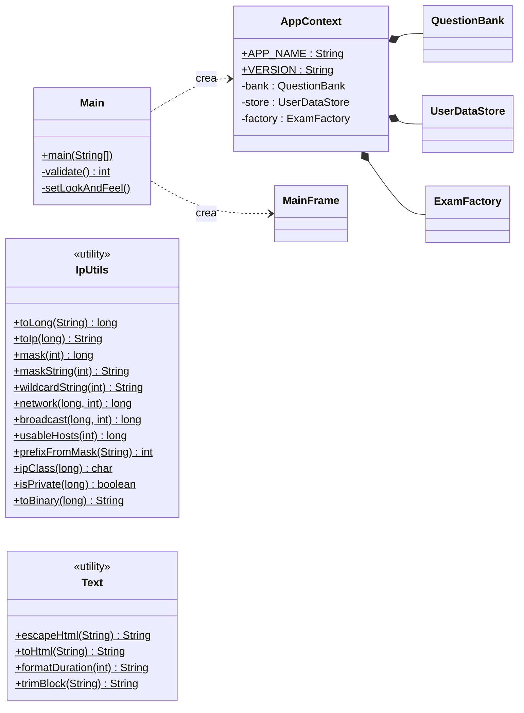

# 07 - Pacchetti `app` e `util`: avvio e attrezzi



---

## `Main` — il punto di partenza

**In parole semplici.** Quando lanci `java -jar ccna-examlab.jar`, Java cerca il metodo
`public static void main(String[] args)` della classe indicata nel `.jar`: è la prima istruzione che viene
eseguita, la "porta d'ingresso".

| Metodo | Cosa fa |
|---|---|
| `main(args)` | attiva l'antialiasing del testo; se il primo argomento è `--validate` esegue `validate()` ed esce con il suo codice; altrimenti, sul filo della grafica (`invokeLater`): imposta il look and feel, carica i dati utente, carica la banca domande, crea `AppContext` e `MainFrame`, mostra la finestra e, se ci sono errori di caricamento, un avviso con i primi 15 |
| `validate()` | carica solo le domande incluse e stampa sulla console il totale, il conteggio per dominio e gli errori. Restituisce 0 se va tutto bene, 1 se ci sono errori: così uno script (es. la CI di GitHub) capisce se fallire |
| `setLookAndFeel()` | usa l'aspetto grafico del sistema operativo; con `-Dccna.laf=Nimbus` (o altro nome) se ne può forzare uno diverso |

**Codice di uscita.** `System.exit(0)` = "tutto ok", qualunque altro numero = "errore". È una
convenzione di tutti i programmi a riga di comando.

## `AppContext` — il quadro dei servizi

**In parole semplici.** Un contenitore che tiene insieme i tre "servizi" usati ovunque — l'archivio
domande, il magazzino dei dati utente e la fabbrica di esami — così le finestre ricevono un solo oggetto
invece di tre. Contiene anche nome e versione del programma (`APP_NAME`, `VERSION`).

---

## `IpUtils` — calcoli sugli indirizzi IPv4

**L'idea chiave.** Un indirizzo IPv4 come `192.168.10.77` è in realtà un **numero di 32 bit**: i
quattro numeri sono "cifre" in base 256. Trasformandolo in un singolo numero (`long`) i calcoli di
subnetting diventano operazioni semplicissime sui bit.

```
192.168.10.77   =  192×256³ + 168×256² + 10×256 + 77  =  3232238157
in binario      =  11000000.10101000.00001010.01001101
```

| Metodo | Cosa fa | Esempio |
|---|---|---|
| `toLong(ip)` | testo → numero; controlla che ci siano 4 ottetti tra 0 e 255 | `"10.0.0.1"` → 167772161 |
| `toIp(v)` | numero → testo, prendendo 8 bit alla volta (`>> 24 & 255`, …) | 167772161 → `"10.0.0.1"` |
| `mask(p)` | maschera di *p* bit a 1 seguiti da zeri | 26 → `11111111.11111111.11111111.11000000` |
| `maskString(p)` / `wildcardString(p)` | maschera / wildcard in forma puntata | 26 → `255.255.255.192` / `0.0.0.63` |
| `network(ip, p)` | indirizzo **AND** maschera: azzera i bit di host | `192.168.10.77/26` → `192.168.10.64` |
| `broadcast(ip, p)` | rete **OR** (bit di host tutti a 1) | → `192.168.10.127` |
| `usableHosts(p)` | 2^(32−p) − 2; /31 = 2 (RFC 3021), /32 = 1 | 26 → 62 |
| `prefixFromMask(m)` | conta i bit a 1 e verifica che siano contigui | `255.255.240.0` → 20; `255.0.255.0` → errore |
| `ipClass(ip)` | classe storica A-E dal primo ottetto | `172.16.1.1` → B |
| `isPrivate(ip)` | appartiene a 10/8, 172.16/12 o 192.168/16? | |
| `toBinary(v)` | 32 cifre binarie con un punto ogni 8 | |

Spiegazione delle operazioni sui bit nell'[algoritmo 7](08-algoritmi.md#7-generatore-di-subnetting-e-metodo-del-magic-number).

## `Text` — utilità per i testi

| Metodo | Cosa fa |
|---|---|
| `escapeHtml(s)` | sostituisce `< > & "` con i codici HTML, così un testo non viene scambiato per marcatori |
| `toHtml(s)` | testo → HTML semplice: `` `codice` `` in monospazio, `**grassetto**`, a capo → `<br>` (disponibile per estensioni future) |
| `formatDuration(sec)` | 4120 → `1:08:40`; 125 → `02:05` |
| `trimBlock(s)` | toglie le righe vuote iniziali e gli spazi finali **senza** toccare l'indentazione interna (importante per gli exhibit) |
