# 08 - Algoritmi e flowchart

Questo capitolo spiega i **dieci procedimenti più importanti** del programma. Ognuno è descritto in
quattro passi:

1. **In parole semplici**: come lo spiegheresti a voce;
2. **Flowchart**: il disegno del procedimento (rombi = domande sì/no, rettangoli = azioni);
3. **Pseudocodice**: i passi scritti quasi come codice, ma in italiano;
4. **Java**: il codice reale del programma, con commenti.

| # | Procedimento | Dove si trova |
|---|---|---|
| 1 | [Lettura dei file delle domande](#1-lettura-dei-file-delle-domande-parser) | `QuestionParser.parse` |
| 2 | [Correzione di una risposta](#2-correzione-di-una-risposta) | `Question.isAnswered`, `Question.isCorrect` |
| 3 | [Suddivisione negli esami predefiniti](#3-suddivisione-negli-esami-predefiniti) | `ExamFactory.presetExams` |
| 4 | [Esame personalizzato e selezione pesata](#4-esame-personalizzato-e-selezione-pesata) | `ExamFactory.custom`, `weightedPick` |
| 5 | [Calcolo del punteggio](#5-calcolo-del-punteggio) | `Scorer.score`, `ExamResult.getScaledScore` |
| 6 | [Mescolamento delle opzioni](#6-mescolamento-delle-opzioni) | `Question.shuffled` |
| 7 | [Generatore di subnetting e metodo del magic number](#7-generatore-di-subnetting-e-metodo-del-magic-number) | `SubnetQuestionGenerator`, `IpUtils` |
| 8 | [Salvataggio del risultato](#8-salvataggio-del-risultato) | `UserDataStore.recordResult` |
| 9 | [Svolgimento dell'esame: navigazione, timer e consegna](#9-svolgimento-dellesame-navigazione-timer-e-consegna) | `ExamPanel` |
| 10 | [Navigazione tra le schermate](#10-navigazione-tra-le-schermate-mainframe) | `MainFrame` |

---

## 1. Lettura dei file delle domande (parser)

### In parole semplici

Immagina di dover ricopiare a mano delle schede da un quaderno. Leggi una riga alla volta:

- finché non trovi `[Q]` stai leggendo commenti: li ignori;
- quando trovi `[Q]` prendi una scheda bianca;
- se la riga inizia con un'etichetta conosciuta (`text:`, `options:`…) cominci a scrivere in quel
  riquadro della scheda (se dopo i due punti c'è già del testo, lo scrivi subito);
- se la riga non ha etichetta, la aggiungi al riquadro in cui stavi scrivendo (testi su più righe);
- quando trovi `[/Q]` controlli la scheda: se è corretta la metti nello schedario, altrimenti annoti
  l'errore e la butti;
- se il quaderno finisce con una scheda ancora aperta, annoti che manca `[/Q]`.

### Flowchart

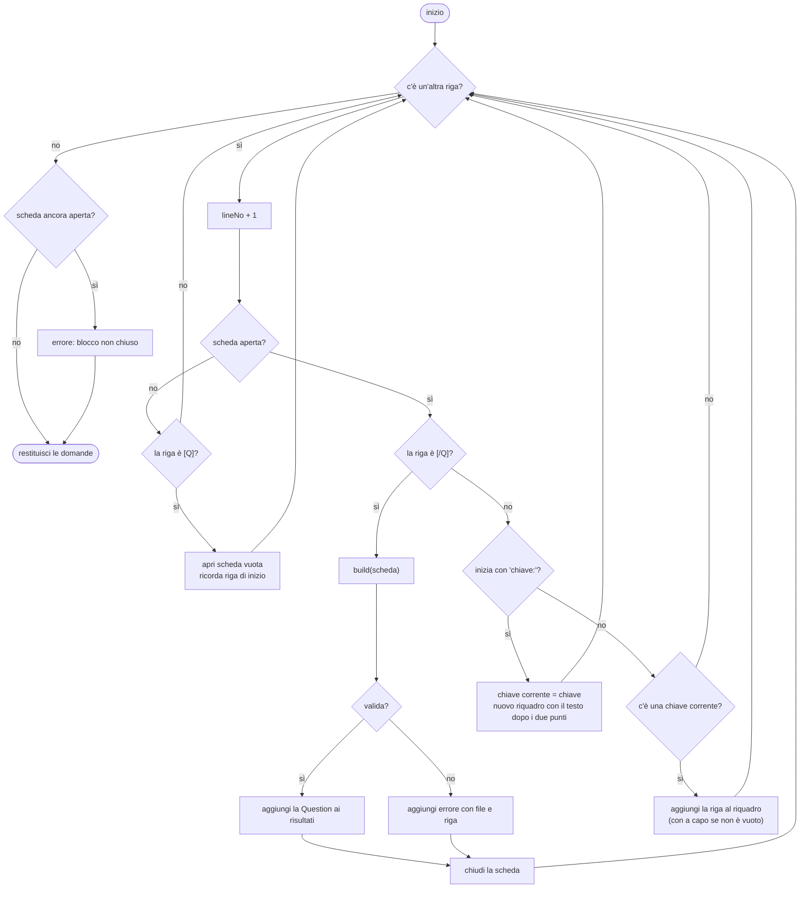

### Pseudocodice

```
funzione parse(file):
    risultati ← lista vuota
    scheda ← niente ; chiaveCorrente ← niente ; numeroRiga ← 0
    per ogni riga del file:
        numeroRiga ← numeroRiga + 1
        se scheda è niente:
            se riga = "[Q]": scheda ← nuova scheda ; inizioBlocco ← numeroRiga
            passa alla riga successiva
        se riga = "[/Q]":
            prova: aggiungi costruisciDomanda(scheda) a risultati
            se fallisce: annota errore "file (blocco alla riga inizioBlocco): motivo"
            scheda ← niente ; passa alla riga successiva
        se riga corrisponde a "chiave: valore":
            chiaveCorrente ← chiave ; scheda[chiave] ← valore
        altrimenti se chiaveCorrente esiste:
            scheda[chiaveCorrente] ← scheda[chiaveCorrente] + a capo + riga
    se scheda non è niente: annota errore "blocco non chiuso"
    restituisci risultati
```

### Java (`QuestionParser.parse`)

```java
while ((line = br.readLine()) != null) {        // leggi finché ci sono righe
    lineNo++;
    String trimmed = line.trim();               // riga senza spazi agli estremi
    if (fields == null) {                       // nessuna scheda aperta
        if (trimmed.equals("[Q]")) {
            fields = new LinkedHashMap<>();     // scheda nuova: chiave → testo
            currentKey = null;
            blockStart = lineNo;
        }
        continue;                               // tutto il resto fuori blocco è ignorato
    }
    if (trimmed.equals("[/Q]")) {
        try {
            result.add(build(fields, source));  // trasforma la scheda in Question (con controlli)
        } catch (QuestionParseException | RuntimeException e) {
            errors.add(source + " (blocco alla riga " + blockStart + "): " + e.getMessage());
        }
        fields = null;
        continue;
    }
    Matcher m = KEY.matcher(line);              // la riga è "chiave: valore"?
    if (m.matches()) {
        currentKey = m.group(1);
        StringBuilder sb = new StringBuilder();
        if (!m.group(2).isBlank()) sb.append(m.group(2));
        fields.put(currentKey, sb);
    } else if (currentKey != null) {            // riga di continuazione
        StringBuilder sb = fields.get(currentKey);
        if (sb.length() > 0) sb.append('\n');
        sb.append(line);
    }
}
if (fields != null) {
    errors.add(source + ": blocco [Q] alla riga " + blockStart + " non chiuso con [/Q]");
}
```

**L'espressione regolare `KEY`** è
`^(id|domain|type|text|exhibit|options|answer|explanation|reference|items|targets|shuffle)\s*:\s?(.*)$`
e si legge: "all'inizio della riga (`^`) una delle parole elencate, eventuali spazi, i due punti, al
massimo uno spazio, e poi qualunque cosa fino alla fine (`$`)". Le parentesi tonde "catturano" la chiave
(gruppo 1) e il valore (gruppo 2).

**Dopo il ciclo**, `build()` interpreta i riquadri: per SINGLE/MULTI divide `answer` su virgole/spazi e
converte ogni lettera in posizione (`'B' - 'A' = 1`); per FILL divide su `|`; per DRAG divide ogni riga di
`items` su `=>`. Infine `Question.Builder.build()` esegue i controlli di coerenza (capitolo 03).

---

## 2. Correzione di una risposta

### In parole semplici

Ogni domanda sa correggersi da sola. Prima di tutto c'è una domanda preliminare: **hai risposto in modo
completo?** (serve per la barra di avanzamento e per l'avviso "domande incomplete"). Poi la correzione
vera, sempre "tutto o niente":

- **Scelta singola o multipla**: l'insieme delle lettere scelte deve essere *identico* all'insieme
  giusto. Se le giuste sono B e D, scegliere solo B è sbagliato, scegliere B, C e D è sbagliato.
- **Risposta aperta**: il testo scritto, ripulito (minuscole, spazi superflui tolti), deve coincidere
  con una delle risposte accettate.
- **Abbinamento**: ogni elemento deve essere abbinato alla categoria giusta; basta un errore e la
  domanda è sbagliata.

### Flowchart

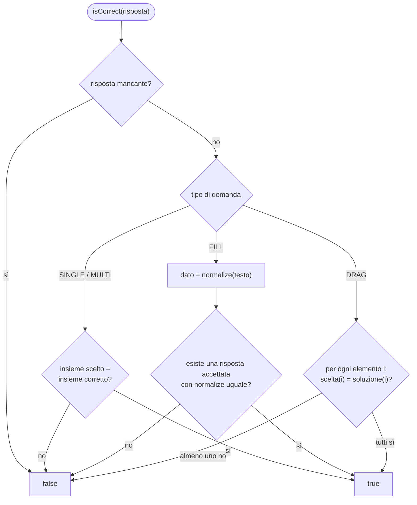

### Pseudocodice

```
funzione isAnswered(r):
    SINGLE → una sola opzione scelta
    MULTI  → numero di opzioni scelte = numero di opzioni corrette
    FILL   → testo non vuoto
    DRAG   → tutti gli elementi hanno una categoria

funzione isCorrect(r):
    SINGLE, MULTI → scelte(r) = corrette
    FILL → per ogni risposta accettata a: se normalizza(a) = normalizza(testo(r)) → vero ; altrimenti falso
    DRAG → per ogni elemento i: se scelta(i) ≠ soluzione(i) → falso ; alla fine vero
```

### Java (`Question.isCorrect`)

```java
switch (type) {
    case SINGLE:
    case MULTI:
        return r.getSelected().equals(correctOptions);   // confronto tra insiemi
    case FILL:
        String given = normalize(r.getFillText());
        for (String a : acceptedAnswers) {
            if (normalize(a).equals(given)) return true;
        }
        return false;
    case DRAG:
        for (int i = 0; i < dragItems.size(); i++) {
            if (!Objects.equals(r.getDragAnswer(i), dragSolution.get(i))) return false;
        }
        return true;
    default:
        return false;
}
```

`Objects.equals(a, b)` è un confronto "sicuro" che funziona anche se uno dei due è `null` (elemento non
abbinato), senza causare errori.

---

## 3. Suddivisione negli esami predefiniti

### In parole semplici

Vogliamo dividere tutte le domande in alcuni esami (A, B, C, D…) che:
- **non abbiano domande in comune** (così ogni esame è "nuovo");
- abbiano ciascuno **la stessa proporzione di argomenti** dell'esame reale;
- siano **sempre uguali** a ogni avvio (l'Esame A non deve cambiare, così puoi confrontare i tentativi).

È come distribuire le carte a quattro giocatori: per ogni seme (dominio) mescoli le carte del seme e
le dai una a testa, a giro. Così ogni giocatore riceve circa un quarto di ogni seme. Per avere sempre la
stessa distribuzione si usa un **mescolamento con seme fisso** (`PRESET_SEED`): è "casuale" ma
ripetibile, come rimescolare un mazzo sempre con gli stessi identici gesti.

Quanti esami? `numero di domande ÷ 70` (divisione intera, minimo 1). Con 298 domande: 298 ÷ 70 = 4.

### Flowchart

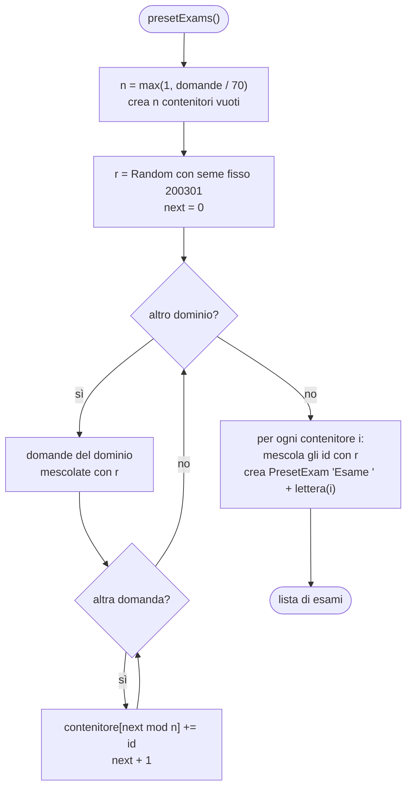

### Pseudocodice

```
n ← max(1, totaleDomande ÷ 70)
contenitori ← n liste vuote
r ← generatore casuale con seme 200301
next ← 0
per ogni dominio nell'ordine 1.0 … 6.0:
    domande ← domande del dominio, mescolate con r
    per ogni domanda: contenitori[next mod n].aggiungi(id) ; next ← next + 1
per i da 0 a n-1:
    mescola contenitori[i] con r
    crea esame "Esame " + ('A' + i) con contenitori[i]
```

Nota: `next` **non** riparte da zero a ogni dominio, così gli esami con una domanda in più non sono
sempre gli stessi.

### Java (`ExamFactory.presetExams`)

```java
int n = Math.max(1, bank.size() / PRESET_SIZE);
List<List<String>> buckets = new ArrayList<>();
for (int i = 0; i < n; i++) buckets.add(new ArrayList<>());
Random r = new Random(PRESET_SEED);          // seme fisso → stessa suddivisione a ogni avvio
int next = 0;
for (Domain d : Domain.values()) {
    List<Question> qs = bank.byDomain(d);
    Collections.shuffle(qs, r);
    for (Question q : qs) {
        buckets.get(next % n).add(q.getId());   // distribuzione "a giro"
        next++;
    }
}
List<PresetExam> exams = new ArrayList<>();
for (int i = 0; i < n; i++) {
    List<String> ids = buckets.get(i);
    Collections.shuffle(ids, r);                // l'ordine delle domande non segue i domini
    exams.add(new PresetExam("Esame " + (char) ('A' + i), ids));
}
```

⚠️ **Attenzione per chi mantiene il programma:** aggiungere o togliere domande cambia la suddivisione
(e quindi il contenuto di Esame A, B…). Lo storico resta valido ma i tentativi precedenti erano su un
insieme di domande un po' diverso.

---

## 4. Esame personalizzato e selezione pesata

### In parole semplici

1. **Filtra**: dalla banca tieni solo le domande dei domini scelti che passano il filtro
   (es. "sbagliate l'ultima volta").
2. **Scegli**: se è attiva l'opzione "pesi del blueprint", calcola quante domande spettano a ogni
   dominio in proporzione al suo peso; altrimenti prendi domande a caso.
3. **Mescola le opzioni** di ogni domanda.
4. **Aggiungi** le domande di subnetting generate, se richieste.
5. Se non c'è nessuna domanda restituisci "niente" (l'interfaccia mostrerà un avviso), altrimenti
   **mescola l'ordine** e crea la sessione.

**La selezione pesata** funziona come la ripartizione dei seggi: il dominio IP Connectivity pesa 25 su
100, quindi in un esame da 40 domande gli spettano 40 × 25 / 100 = 10 domande. Se un dominio non ha
abbastanza domande (es. hai filtrato solo le marcate), i posti vuoti vengono riempiti con le domande
"avanzate" degli altri domini. Siccome gli arrotondamenti possono far superare il totale di 1, alla fine
si tolgono le eventuali domande in eccesso.

Esempio con 40 domande e tutti i domini: 8 + 8 + 10 + 4 + 6 + 4 = 40.

### Flowchart

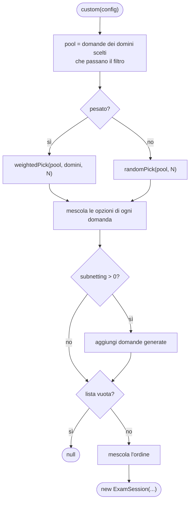

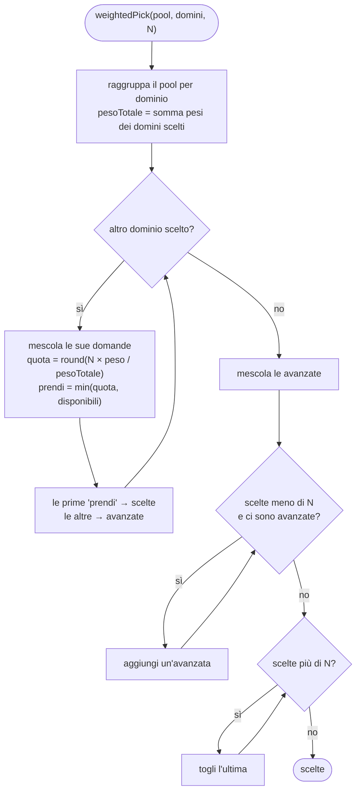

### Pseudocodice

```
funzione weightedPick(pool, domini, N):
    perDominio ← raggruppa pool per dominio
    pesoTotale ← somma dei pesi dei domini scelti
    scelte ← [] ; avanzate ← []
    per ogni dominio d scelto:
        qs ← perDominio[d] mescolate
        quota ← arrotonda(N × peso(d) / pesoTotale)
        prendi ← minimo(quota, lunghezza(qs))
        scelte += primi 'prendi' di qs
        avanzate += resto di qs
    mescola avanzate
    finché lunghezza(scelte) < N e restano avanzate: aggiungi un'avanzata a scelte
    finché lunghezza(scelte) > N: togli l'ultima di scelte
    restituisci scelte
```

### Java (`ExamFactory.weightedPick`)

```java
for (Domain d : domains) {
    List<Question> qs = byDomain.getOrDefault(d, new ArrayList<>());
    Collections.shuffle(qs, random);
    int quota = totalWeight == 0 ? 0
        : (int) Math.round((double) count * d.getWeight() / totalWeight);
    int take = Math.min(quota, qs.size());
    chosen.addAll(qs.subList(0, take));               // la quota del dominio
    leftovers.addAll(qs.subList(take, qs.size()));    // il resto, per riempire eventuali buchi
}
Collections.shuffle(leftovers, random);
for (Question q : leftovers) {
    if (chosen.size() >= count) break;
    chosen.add(q);
}
while (chosen.size() > count) {
    chosen.remove(chosen.size() - 1);                 // correzione degli arrotondamenti
}
```

Perché `(double) count`: in Java `30 * 25 / 100` tra interi darebbe un risultato troncato; convertendo
in `double` si ottiene 7,5 e `Math.round` lo arrotonda correttamente a 8.

---

## 5. Calcolo del punteggio

### In parole semplici

Si contano le risposte giuste (vedi algoritmo 2), in totale e per dominio. Il punteggio Cisco è su una
scala da 300 a 1000: il programma la riproduce con una proporzione lineare. Chi risponde a tutto male
prende 300, chi risponde a tutto bene 1000.

```
punteggio = 300 + 700 × (corrette / totale)       arrotondato all'intero
superato  = punteggio ≥ 825                        (cioè almeno il 75% di risposte giuste)
```

Esempio: 60 giuste su 75 → 0,8 × 700 = 560 → 300 + 560 = **860 → superato**.

Il flowchart di `Scorer.score` è nel [capitolo 05](05-classi-engine.md#scorer--il-correttore).

### Java (`ExamResult.getScaledScore`)

```java
if (total == 0) return MIN_SCORE;
return (int) Math.round(MIN_SCORE + (MAX_SCORE - MIN_SCORE) * ((double) correct / total));
```

⚠️ È una **stima**: Cisco usa un metodo statistico non pubblico e le domande non pesano tutte uguale.
Il valore serve per misurare i propri progressi, non per prevedere il voto esatto.

---

## 6. Mescolamento delle opzioni

### In parole semplici

Se le opzioni fossero sempre nello stesso ordine, dopo qualche ripetizione si memorizzerebbe "la
risposta è la B" invece del concetto. Per questo, ogni volta che una domanda entra in un esame, se ne
fa una **copia con le opzioni rimescolate**.

Il trucco è tenere traccia di dove finisce ogni opzione. Si mescola una lista di posizioni, ad esempio
`[2, 0, 3, 1]`, che significa: "la nuova A è la vecchia C, la nuova B è la vecchia A…". Per ogni nuova
posizione si copia il testo dell'opzione originale e, se l'originale era corretta, si segna come
corretta la nuova posizione.

| Nuova posizione | Vecchia posizione | Testo | Era corretta? |
|---|---|---|---|
| A (0) | 2 (C) | "192.168.3.2" | sì → la nuova risposta è **A** |
| B (1) | 0 (A) | "192.168.1.2" | no |
| C (2) | 3 (D) | "192.168.4.2" | no |
| D (3) | 1 (B) | "192.168.2.2" | no |

Le domande DRAG e FILL non vengono mescolate, e nemmeno quelle con `shuffle: no` nel file.

### Flowchart

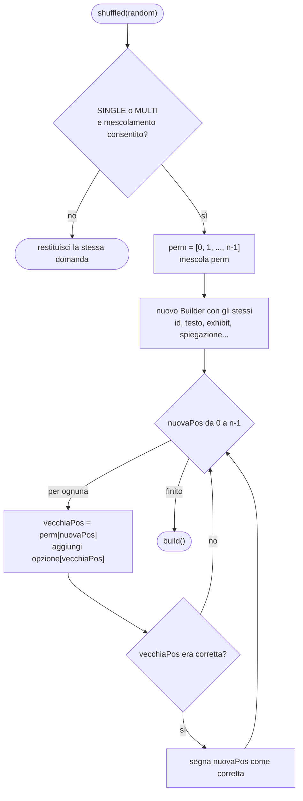

### Java (`Question.shuffled`)

```java
if ((type != QuestionType.SINGLE && type != QuestionType.MULTI) || !shuffleAllowed) {
    return this;                                   // niente da mescolare
}
List<Integer> perm = new ArrayList<>();
for (int i = 0; i < options.size(); i++) perm.add(i);
Collections.shuffle(perm, random);                 // es. [2, 0, 3, 1]
Builder b = new Builder()
    .id(id).domain(domain).type(type).text(text).exhibit(exhibit)
    .explanation(explanation).reference(reference).generated(generated)
    .shuffleAllowed(shuffleAllowed).source(source);
for (int newIdx = 0; newIdx < perm.size(); newIdx++) {
    int oldIdx = perm.get(newIdx);
    b.option(options.get(oldIdx));
    if (correctOptions.contains(oldIdx)) b.correct(newIdx);
}
return b.build();
```

La copia ha **lo stesso ID**: le statistiche continuano a riferirsi alla stessa domanda, qualunque sia
l'ordine delle opzioni. Per questo le spiegazioni non devono mai citare le lettere ("l'opzione C…").

---

## 7. Generatore di subnetting e metodo del magic number

### In parole semplici

**Come si risolve a mano** (ed è ciò che il programma scrive nella spiegazione):

1. Dal prefisso ricavi la maschera: /26 = 255.255.255.192.
2. Trovi l'**ottetto interessante**: quello in cui la maschera non è né 255 né 0 (qui il 4°).
3. **Magic number** (block size) = 256 − valore della maschera in quell'ottetto = 256 − 192 = **64**.
4. Le subnet iniziano dai multipli del magic number: 0, 64, 128, 192.
5. Guardi in quale blocco cade l'host (.77 → blocco 64-127): rete .64, broadcast .127, host .65-.126.

**Come lo fa il computer.** Il computer non ragiona per ottetti: trasforma l'indirizzo in un numero da
32 bit e usa due operazioni logiche:

- **AND con la maschera** → azzera i bit di host → **indirizzo di rete**;
- **OR con la wildcard** (bit di host a 1) → **broadcast**.

```
indirizzo  192.168.10.77   11000000.10101000.00001010.01001101
maschera   /26             11111111.11111111.11111111.11000000
AND        rete            11000000.10101000.00001010.01000000  = 192.168.10.64
wildcard                   00000000.00000000.00000000.00111111
OR         broadcast       11000000.10101000.00001010.01111111  = 192.168.10.127
```

### Flowchart (generazione di una domanda)

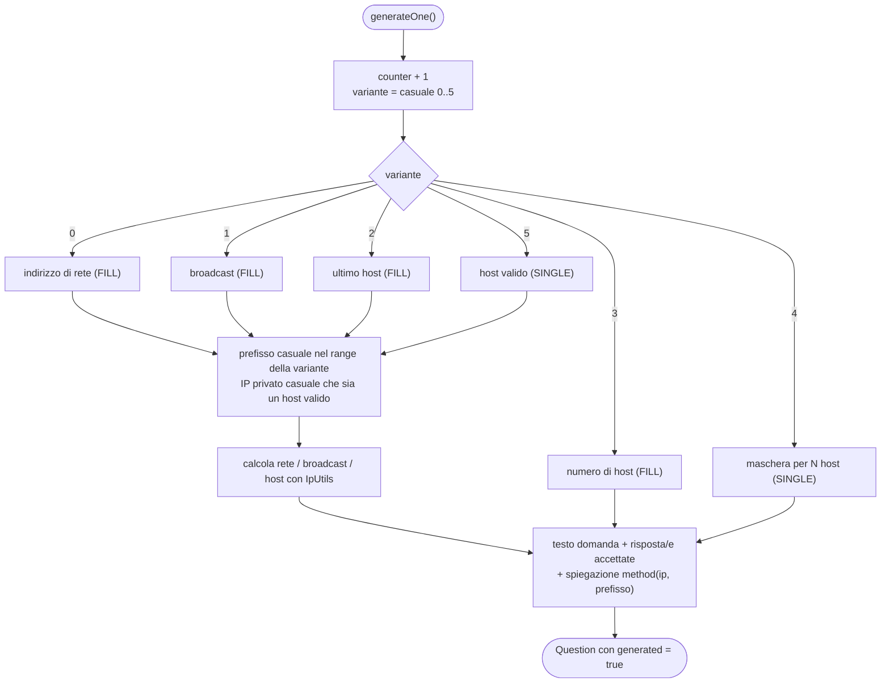

### Pseudocodice (spiegazione col magic number)

```
funzione method(ip, prefisso):
    ottetto ← (prefisso − 1) ÷ 8                      # 0 = primo ottetto, 3 = quarto
    valoreMaschera ← byte numero 'ottetto' della maschera
    blocco ← 256 − valoreMaschera
    valoreHost ← byte numero 'ottetto' dell'indirizzo
    inizioBlocco ← (valoreHost ÷ blocco) × blocco     # divisione intera
    scrivi i 5 passi con rete, broadcast e range degli host
```

Perché `(prefisso − 1) ÷ 8`: per /26 → 25 ÷ 8 = 3 → quarto ottetto; per /24 → 23 ÷ 8 = 2 → terzo
ottetto (dove la maschera vale 255 e il blocco è 1); per /20 → 19 ÷ 8 = 2 → terzo ottetto.

### Java (`IpUtils` e `SubnetQuestionGenerator.method`)

```java
public static long mask(int prefix) {          // 'prefix' bit a 1 a sinistra
    return prefix == 0 ? 0 : (0xFFFFFFFFL << (32 - prefix)) & 0xFFFFFFFFL;
}
public static long network(long ip, int prefix)   { return ip & mask(prefix); }
public static long broadcast(long ip, int prefix) {
    return network(ip, prefix) | (~mask(prefix) & 0xFFFFFFFFL);
}

// in SubnetQuestionGenerator.method(...)
int octetIndex = (prefix - 1) / 8;
int maskOctet = (int) ((mask >> (24 - 8 * octetIndex)) & 255);   // estrae il byte
int block = 256 - maskOctet;
int ipOctet = (int) ((ip >> (24 - 8 * octetIndex)) & 255);
int netOctet = (ipOctet / block) * block;
```

- `<<` e `>>` spostano i bit a sinistra/destra; `& 255` tiene solo gli ultimi 8 bit (un ottetto).
- `0xFFFFFFFFL` è il numero con 32 bit a 1; serve a "tagliare" il risultato a 32 bit, perché `long` ne ha 64.
- `~` inverte tutti i bit (maschera → wildcard).

**Garanzia di qualità.** Il generatore è stato verificato su 3000 domande: per ognuna la risposta
indicata come corretta viene effettivamente accettata da `isCorrect`, e le opzioni delle domande a scelta
non sono mai duplicate.

---

## 8. Salvataggio del risultato

### In parole semplici

Quando consegni un esame succedono due cose:

1. il **verbale** dell'esame viene aggiunto in fondo a `history.tsv` (senza riscrivere le righe
   precedenti, come aggiungere una pagina a un diario);
2. la **pagella di ogni domanda** viene aggiornata: +1 viste, +1 giuste se corretta, "ultima volta
   giusta/sbagliata", e "marcata" se l'avevi marcata. Poi `stats.tsv` viene riscritto per intero.

Le domande generate (subnetting) non hanno pagella perché sono diverse ogni volta.
Se un file non si può scrivere (disco pieno, permessi) il programma lo segnala sulla console ma
**non si blocca**: perdi solo quel salvataggio.

### Flowchart

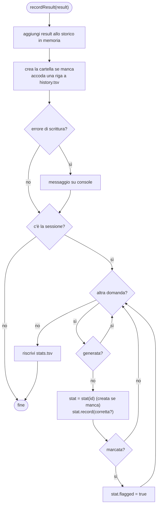

### Java (`UserDataStore.recordResult`)

```java
history.add(result);
try {
    Files.createDirectories(dir);
    Files.writeString(historyFile, toHistoryLine(result) + System.lineSeparator(),
        StandardCharsets.UTF_8, StandardOpenOption.CREATE, StandardOpenOption.APPEND);
} catch (IOException e) {
    System.err.println("Errore salvataggio storico: " + e.getMessage());
}
ExamSession s = result.getSession();
if (s != null) {
    for (int i = 0; i < s.size(); i++) {
        Question q = s.getQuestion(i);
        if (q.isGenerated()) continue;
        QuestionStat st = stat(q.getId());
        st.record(q.isCorrect(s.getResponse(i)));
        if (s.isMarked(i)) st.setFlagged(true);
    }
    saveStats();
}
```

`CREATE, APPEND` = "crea il file se non esiste, altrimenti scrivi in fondo".

---

## 9. Svolgimento dell'esame: navigazione, timer e consegna

### In parole semplici

- **Mostrare una domanda** (`go`): si disegna la domanda; se in Studio la risposta è già stata
  rivelata, la si mostra in sola lettura con la correzione.
- **Andare avanti** (`next`): se l'esame imita quello reale (niente ritorno indietro) e non hai risposto
  completamente, il programma chiede conferma, perché non potrai più tornare. Sull'ultima domanda,
  "avanti" significa "consegna".
- **Il timer**: ogni secondo aggiunge 1 al tempo trascorso e aggiorna il cronometro. In Simulazione il
  cronometro va alla rovescia e diventa rosa negli ultimi 5 minuti; a zero l'esame viene consegnato
  automaticamente.
- **La consegna** (`finish`) può avvenire una volta sola: un "interruttore" (`finished`) impedisce che,
  ad esempio, il tempo scada mentre stai già confermando la consegna e l'esame venga corretto due volte.

### Flowchart: pulsante "Successiva"

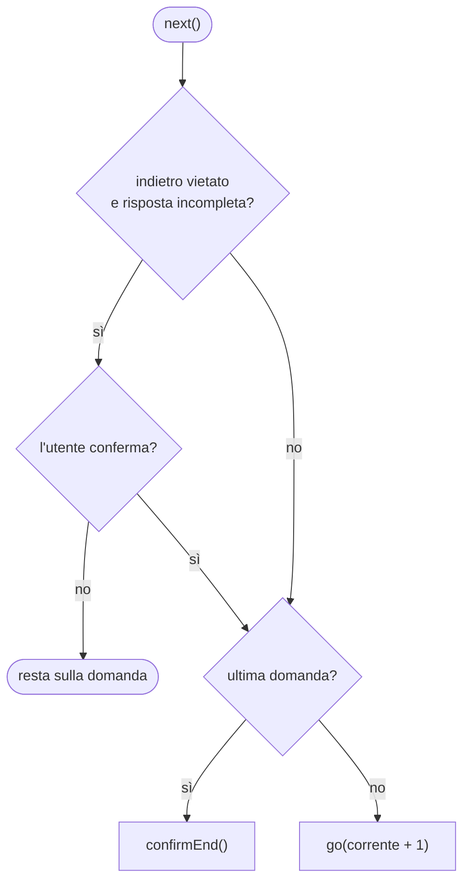

### Flowchart: ogni secondo (timer)

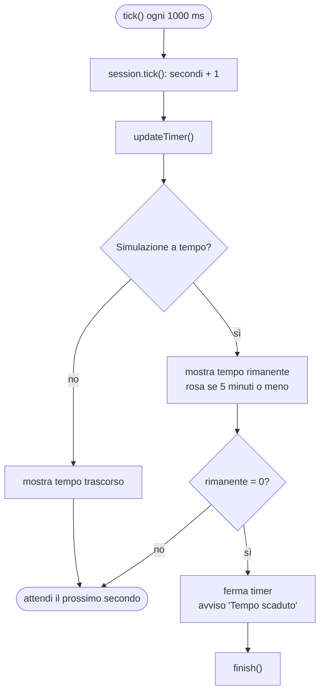

### Flowchart: consegna

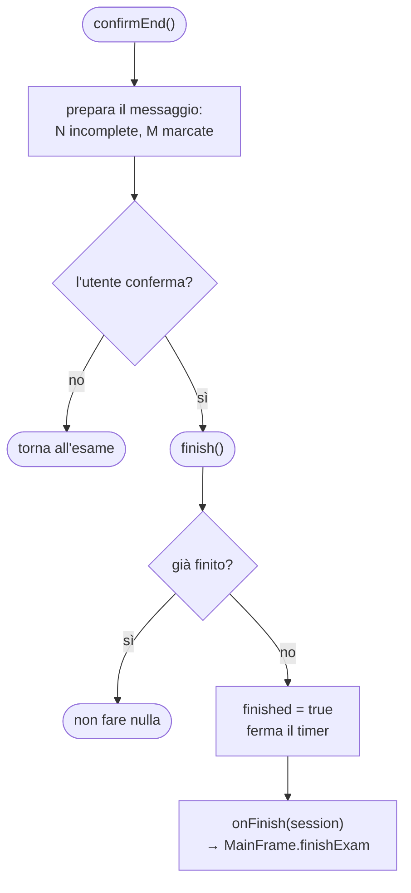

### Java (`ExamPanel.next`, `tick`, `finish`)

```java
private void next() {
    int cur = session.getCurrent();
    if (!session.isAllowBack() && !session.isAnswered(cur)) {
        int c = JOptionPane.showConfirmDialog(this, "Non hai risposto completamente ...",
            "Domanda senza risposta", JOptionPane.YES_NO_OPTION, JOptionPane.WARNING_MESSAGE);
        if (c != JOptionPane.YES_OPTION) return;
    }
    if (cur == session.size() - 1) confirmEnd();
    else go(cur + 1);
}

private void tick() {
    session.tick();
    updateTimer();
    if (session.isTimed() && session.getRemainingSeconds() == 0) {
        timer.stop();
        JOptionPane.showMessageDialog(this, "Tempo scaduto! L'esame viene consegnato.", ...);
        finish();
    }
}

private void finish() {
    if (finished) return;      // protezione contro la doppia consegna
    finished = true;
    timer.stop();
    onFinish.accept(session);  // la "richiamata" fornita da MainFrame
}
```

**Callback (richiamata).** `ExamPanel` non sa cosa succede dopo la consegna: riceve nel costruttore una
funzione `onFinish` e la chiama. È `MainFrame` a decidere che quella funzione significa "correggi, salva,
mostra il report". Così `ExamPanel` resta riutilizzabile e indipendente.

---

## 10. Navigazione tra le schermate (MainFrame)

### In parole semplici

La finestra principale è un mazzo di tre carte: **home**, **exam**, **results**. Si vede una carta
alla volta. Quando parte un esame si crea la carta "exam" e la si porta in cima; quando finisce si
toglie, si crea la carta "results" e si mostra quella. Tornando al menu si aggiornano i dati della home
(tentativi, punteggi, grafico).

### Flowchart

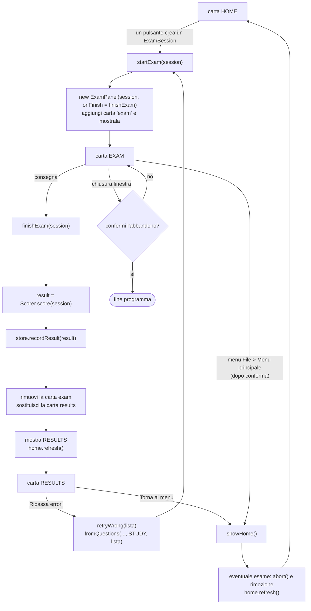

### Java (`MainFrame.finishExam`)

```java
private void finishExam(ExamSession session) {
    ExamResult result = Scorer.score(session);        // 1. correggi
    ctx.getStore().recordResult(result);              // 2. salva
    if (examPanel != null) {                          // 3. togli la carta dell'esame
        root.remove(examPanel);
        examPanel = null;
    }
    if (resultsPanel != null) root.remove(resultsPanel);
    resultsPanel = new ResultsPanel(result, this::showHome, this::retryWrong);
    root.add(resultsPanel, "results");                // 4. mostra il report
    cards.show(root, "results");
    home.refresh();                                   // 5. aggiorna tentativi e grafico
}
```

`this::showHome` e `this::retryWrong` sono **riferimenti a metodi**: passiamo al `ResultsPanel` le azioni
da eseguire quando l'utente clicca "Torna al menu" o "Ripassa errori", con lo stesso meccanismo di
callback visto sopra.
